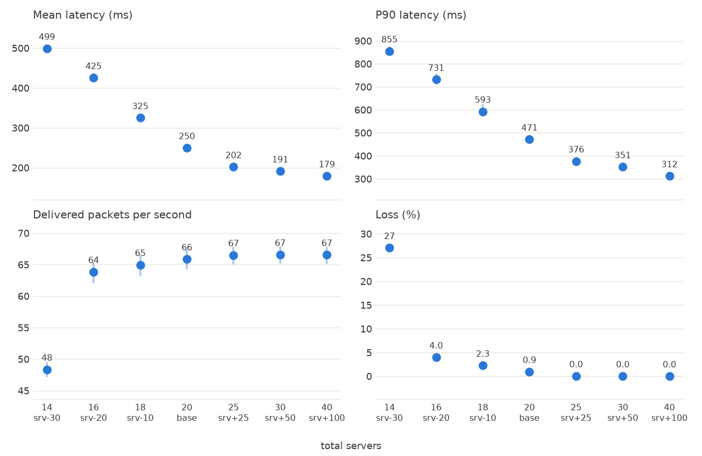
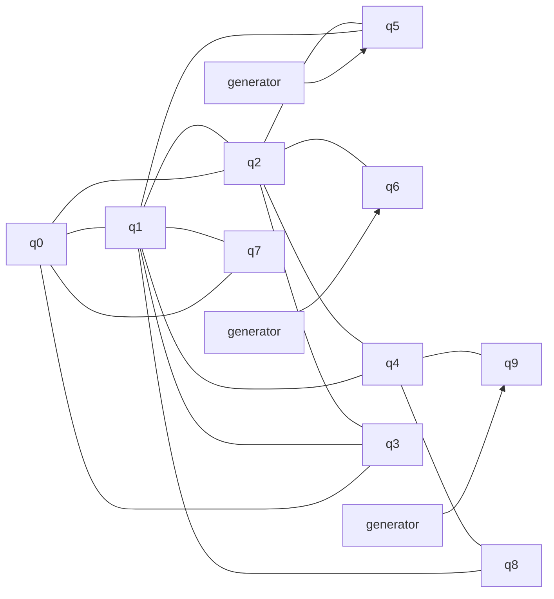

# Small study: packet routing across 10 routers

IPv4 packets are forwarded across 10 routers, each one a queue and a monolithic server function. A baseline and six server budgets give seven sets, each with six plots, and each set runs on three traffic seeds.

**Where these results came from.** [results/summary.md](results/summary.md) names the machine that produced the current numbers. They come from the course VM (`dos26`, 4 cores), which is how the pipeline was tested. [Running it on Sooner](#run-it) regenerates everything, and the numbers below should then be checked against the new summary.

The main finding: **at this load, capacity runs out at the edge of the network, not at the hubs.** The two one-link source routers, q6 and q9, are the first to overflow. Going from 16 to 14 servers leaves them with one server each, and loss jumps from 3.5% to 26%.



Dots are means over three seeds, and the bars show the range. Set names are the change in servers from the baseline.

## 1. How the process maps to a queueing problem

The full model is in the [application README](../../../implementation/obj-b.packets/README.md).

| Real network | Queueing model |
| --- | --- |
| Packet | Job, with a destination IPv4 address and a TTL |
| Router | One queue system: a buffer and a server function |
| Buffer overflow | `ERROR QUEUE-FULL`, which is packet loss |
| Forwarding capacity | Server count, so a router handles up to $c / E[W]$ packets per second |
| Routing table | Longest-prefix lookup from destination to next hop |
| Link | Edge from a server function to the next router's queue |
| Hosts sending traffic | Workload generator feeding a source router |
| Delivery | Exit to a sink file at the destination router |

This is an open network with fixed routes, so load can be predicted before a run. With offered rate $\lambda$, router $i$ receives $\lambda v_i$ packets per second, where $v_i$ is its visits per packet from the routing tables:

$$\rho_i = \frac{\lambda\, v_i\, E[W]}{c_i}$$

## 2. The metrics that matter

| Metric | Reading here |
| --- | --- |
| Utilization | Share of a router's forwarding capacity in use |
| Saturation | Packets waiting in a router's buffer |
| Errors | Packets dropped because a buffer was full |
| Latency | First arrival to delivery, for delivered packets only |
| Throughput | Packets delivered per second |
| Event traces | Where the slowest packets spent their time: waiting or being served |

Latency only covers packets that survive, so it must always be read beside loss. Heavy dropping can make latency look better than it is.

## 3. How it maps onto the framework

### The network



The 10 routers are a seeded random-walk sample of the SNAP `as-733` Autonomous System graph, with 16 links. Every router is also a possible destination, with its own sink.

### Configuring, implementing, and orchestrating

| Question | Answer |
| --- | --- |
| Configure the files | [study.json](study.json) holds the size, waits, buffers, budgets, and seeds. `build_network.py` expands it into routing tables, addresses, and `queues.csv`. |
| Implement the queues | Unchanged Objective A `queue.py` |
| Implement the server functions | [server-monolith](../../../implementation/obj-b.packets/server-monolith/README.md): validate, look up, then forward or deliver. A [C++ port](../../../implementation/obj-b.packets/cpp/README.md) can be swapped in with `--server-bin`. These results use the Python one. |
| Orchestrate | `run_network` in `run_local.py` starts server functions, then queues, then generators. A run ends when every packet is delivered or has a logged drop. |
| Edges | gRPC between all queues and server functions. A FIFO from each generator to its queue, and a file for each sink. |

### Workload

Each run sends 5,000 packets, inside the SMALL band of 1,000 to 10,000 jobs. The [generator README](../../../implementation/obj-b.packets/workload-generator/README.md) explains each choice:

- **Arrivals** are exponential, because traffic combines many independent hosts.
- **Destinations** are uniform, because no measured traffic matrix goes with this graph, so load differences come from the topology.
- **Packet sizes** follow the IMIX mix (40, 576, and 1500 bytes).
- **Each packet has three tasks**: validate (5 ms), lookup (15 ms), and forward (proportional to size, mean 30 ms).

The rate is fixed at 68.7 packets per second, split evenly across three sources. That puts the busiest baseline router at a predicted 70%. Measured offered rates averaged 66.8 packets per second, because of overhead around each sleep.

### What stays fixed across the seven sets

Servers are the only resource that changes. Each traffic seed sends the same packets in every set, and buffers stay at their baseline sizes. Each budget is split in proportion to predicted load, with at least one server per router, so every set really changes the bottlenecks.

## 4. Results: how does the system behave?

| Set | Servers | Delivered /s | Mean latency (ms) | Median (ms) | P90 (ms) | Loss (%) |
| --- | ---: | ---: | ---: | ---: | ---: | ---: |
| srv-30 | 14 | 49.2 | 487 | 479 | 827 | 25.92 |
| srv-20 | 16 | 64.3 | 403 | 371 | 698 | 3.52 |
| srv-10 | 18 | 65.5 | 310 | 276 | 566 | 1.69 |
| base | 20 | 66.1 | 240 | 218 | 457 | 0.78 |
| srv+25 | 25 | 66.7 | 196 | 146 | 366 | 0.00 |
| srv+50 | 30 | 66.7 | 188 | 138 | 345 | 0.00 |
| srv+100 | 40 | 66.7 | 175 | 107 | 309 | 0.00 |

Each of the 21 runs accounted for all 5,000 packets, with no routing faults. The per-queue server counts and utilization are in [results/summary.md](results/summary.md).

- **The model predicts the system.** Measured utilization is within 0.03 of the routing-table prediction wherever $\rho < 1$ in the baseline and the larger budgets, for example 0.69 against 0.70 at q6. It runs further below prediction once drops begin at srv-30.
- **Most of the delay is service once servers are plentiful.** The mean wait per visit falls from 26 ms at the baseline to 3.5 ms at srv+100, while service stays at 51 ms. The mean packet makes 3.2 visits, so zero-load latency is about 160 ms, and srv+100 reaches 175 ms.
- **The baseline already loses a little.** q6 and q9 run at 70% with only 8 buffer slots, so bursts overflow them even though the average load fits.
- **The cliff at 14 servers is arithmetic, not bad luck.** The servers each router needs to stay below full load add up to 16: 2 each for q1, q2, q4, q5, q6, and q9, and 1 each for q0, q3, q7, and q8. No allocation of 14 servers can stay below full load.

  At srv-30, q6 and q9 have one server each, at a predicted 140%. Nearly all drops happen there, and about 85% of those are the router's own sourced packets, measured on seed 1. q5 has the same load, but the allocator's tie-break gave it the last spare server, so it survives.
- **The srv-30 latency flatters the system.** Its 487 ms mean only counts the 74% of packets that were delivered.

### Does this make sense for a real network?

Mostly, yes. Access links being the bottleneck, loss rising sharply past capacity, and a limit on how much extra capacity helps are all familiar network behavior.

The comparison has limits. Traffic here is smoother than real traffic, which is burstier than Poisson, and sources don't slow down when packets are lost as TCP would. Servers are also whole units on a 10-router network, which makes the cliff sharper than it would be with finer-grained capacity.

## 5. Sensitivity study

### Improving response time and throughput with more resources

| Change | Servers | Mean latency | P90 latency | Throughput | Loss |
| --- | ---: | ---: | ---: | ---: | ---: |
| +25% | 25 | −18% | −20% | +1% | 0.78% to 0 |
| +50% | 30 | −22% | −24% | +1% | 0.78% to 0 |
| +100% | 40 | −27% | −32% | +1% | 0.78% to 0 |

The first +25% does most of the work. It removes all loss and most of the queueing, because it gives q6 and q9 a third server. Throughput barely moves, since the baseline was already delivering nearly everything offered.

Later servers help less, for two reasons. Latency is approaching its zero-load floor, and q7 and q8 keep one server even at +100%, so they still wait 25 to 31 ms per visit. Whole-server allocation leaves them behind.

### Destroying response time and throughput with fewer resources

| Change | Servers | Mean latency | P90 latency | Throughput | Loss |
| --- | ---: | ---: | ---: | ---: | ---: |
| −10% | 18 | +29% | +24% | −1% | 1.69% |
| −20% | 16 | +68% | +53% | −3% | 3.52% |
| −30% | 14 | +103% | +81% | −26% | 25.92% |

The damage isn't proportional. −20% mostly costs latency. −30% takes the network past capacity, and throughput falls with it.

## 6. Takeaways for someone building this

1. **Check the edge first.** q6 and q9 have one link each and the fewest servers among the sources, yet they fail before the seven-link hub q1. Node degree alone would have pointed at the wrong routers.
2. **Predict before you run.** Routing tables plus an offered rate gave utilization within a few percent, and the arithmetic gave the point of collapse.
3. **Capacity comes in whole units.** The total load adds up to 11 servers' worth of work, but the minimum stable budget is 16, because no router can have a fraction of a server. That gap grows when many routers carry small loads.
4. **Keep a margin.** With q6 and q9 at 70%, small buffers lost 0.8% of packets. At 47% (srv+25), they lost none.
5. **Don't judge by latency alone.** At srv-30, median latency is 479 ms and more than a quarter of packets are gone.

## Plots and tools

Each `results/<set>/` folder has the six plots: `utilization.png`, `saturation.png`, `errors.png`, `latency.png`, `throughput.png`, and `longest-jobs.png`. They come from the first seed. The three colored queues are the baseline's three busiest routers in every set, and the rest are gray.

These plots use 1-second bins and weight queue state by time, because the rows are written when a queue changes rather than at a fixed interval. `compute-use` averages rows, so `tools/use.png` can differ from them. `longest-jobs.png` labels its axis "Time step", which is milliseconds here.

**Accessory tools.** Each set's first seed runs all of them, with outputs in `results/<set>/tools/`:

| Tool | Output | Shows |
| --- | --- | --- |
| `filter-by-queue` | `q0-qmet.csv` | One queue's metric rows |
| `filter-by-job` | `longest-job.log`, `../longest-jobs.log` | One or more jobs' events |
| `compute-use` | `quse.csv` | Utilization, saturation, and errors by window |
| `plot-use` | `use.png` | The dashboard view of those windows |
| `derive-sys-metrics` | `sysmetrics.csv` | End-to-end latency and throughput |
| `plot-sys-metrics` | `resplot.png` | The same, plotted |
| `derive-event-metrics` | `emetrics.csv` | Waiting and service for each visit |
| `plot-derive-event-metrics` | `response-hist.png`, `response-scatter.png` | Distribution of visit time, and visit time by arrival |
| `create-event-trace` | `etrace.png`, `../longest-jobs.png` | Job lifelines: the first 40 jobs and the 3 longest |
| `pretty-print-job-trace` | `pp-events.log`, `pp-longest.log` | Readable timelines |

The large text outputs (`events.log`, `pp-events.log`, and the metric CSVs) are gitignored. They are regenerated by a run, and on Sooner they are also in the raw log archive.

## Run it

On this VM, from the repository root, with the venv from the [overview](../README.md#run-on-this-vm):

```text
~/packets-venv/bin/python analysis/obj-b-packets/run_study.py simple
```

On Sooner, after the [one-time setup](../README.md#run-on-sooner):

```text
sbatch --time=00:20:00 analysis/obj-b-packets/simple/run.sbatch --only base --seeds 1
sbatch analysis/obj-b-packets/simple/run.sbatch
```

The first is a 2-minute test of one set, and the second is the whole study, about 30 minutes. The [overview](../README.md) covers copying the code, bringing the plots back, and what to do if a job fails.

## Other files

| Path | Role |
| --- | --- |
| [study.json](study.json) | The study's configuration |
| [run_study.py](../run_study.py) | Runs the sets and writes all results. Shared by every model |
| [run.sbatch](run.sbatch), [../sooner/](../sooner/) | This model's Slurm job, and the setup and job body every model shares |
| `results/summary.md`, `results/metrics-by-run.csv`, `results/plan.json` | Results by set and by run, and the predicted plan |
