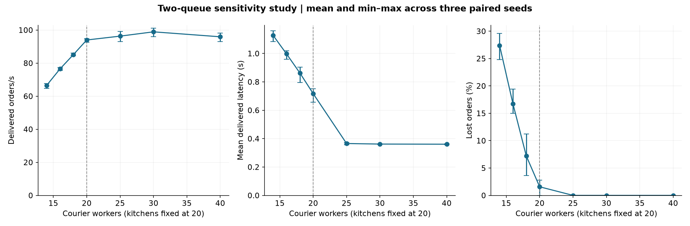
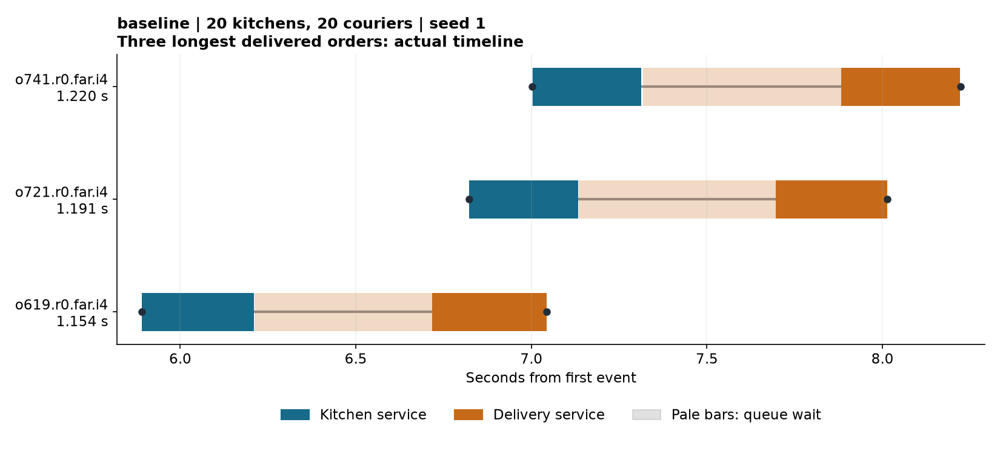

# Small food-delivery queueing study

**Completed: two queues, seven scenario sets, six main plots per set (42 total),
three seeds per set, and 21,000 generated orders.** All 19,413 delivered and
1,587 dropped orders reconcile with the source workload; none are incomplete.
Runs were collected on November 5, 2026, using the C++/gRPC application on one Mac.

The main finding is that **pickup/delivery capacity is the baseline bottleneck**.
Increasing couriers from 20 to 25 reduced mean delivered-order latency from
0.717 to 0.365 seconds (mean paired reduction
48.8%) and eliminated observed losses in all three runs.
Increasing further to 30 or 40 couriers added little latency benefit at the
measured offered load. Cutting the pool to 14 couriers reduced throughput by
29.2% and lost 27.4% of orders.

## 1. Identify the problem and map it to queues

Orders at restaurant r0 require food preparation and courier delivery. The system
should deliver as many orders as possible with short customer waits and few
rejections, using a limited worker budget. q0 represents orders waiting for the
kitchen; q1 represents prepared orders waiting for an available courier. An order
is one job, and preparation/delivery are its two service tasks.

The architecture diagram, distribution decisions, exact configuration, and
implementation mapping are in [METHODS.md](METHODS.md). There are **20 kitchen
workers in every scenario**, **64 pending slots in each queue**, and a variable
courier pool. Sensitivity percentages apply to couriers: +25% couriers means
+12.5% total workers, since kitchens stay fixed. The two queues satisfy the user's
2–10-queue small-system scope; larger queue-count studies remain separate work.

## 2. Which metrics matter, and what do they mean?

Utilization measures busy service capacity; saturation measures waiting orders;
errors measure queue-full rejection. Delivered throughput is successful orders/s.
Latency is original generation to final sink output, for delivered orders. Both
latency and loss must be reported because discarding work can make delivered-only
latency look better. Pickup wait isolates the delay between preparation completion
and courier service. Long-job traces show whether delay comes from work or waiting.

The main plots use **time-weighted** service/waiting state and 0.5 s bins, not
simple averages of asynchronous event rows. Error and throughput plots use
orders/s. Full definitions, units, and tool-specific caveats are documented in
[METHODS.md](METHODS.md#main-metrics-and-six-plots-per-set).

## 3. Configure the framework and generate the workload

[study.json](study.json) defines all seven sets and seeds 1/2/3. Each run generates
1,000 unique orders. The generator requests exponential interarrival gaps with
mean 0.008 real seconds after scaling. Uniform item counts and near/mid/far zones
produce mean requested preparation of 0.15 s and delivery of 0.20 s.

The nominal offered rate is 125 orders/s. **Measured rates averaged roughly
101–105 orders/s by scenario**, because live sleeps, scheduling, and logging add
overhead. Requested gaps and service workloads use paired seeds, but actual
wall-clock arrival times are not identical replay. [metrics-by-run.csv](metrics-by-run.csv)
retains each measured rate; matching workload hashes verify identical order IDs
and requested service durations for each seed across scenarios.

The runner launches serial C++ worker processes on loopback gRPC ports, admits
orders into Python bounded queues, and keeps the stateful courier registry in
Python. Every accepted visit logs its lifecycle. The study drains and checks all
work before collecting the next scenario. This is an asynchronous implementation,
not a numerical queue simulator.

## 4. Results: how does the system behave?

Values below are means over three seeds. P95 is the mean of within-run P95s.
Percentage changes are averaged over matched-seed comparisons against baseline.
The comparison figure's bars show min–max across seeds, not confidence intervals.

| Scenario | Couriers | Delivered orders/s | Mean latency (s) | P95 latency (s) | Loss (%) | Paired throughput change | Paired latency change |
| --- | ---: | ---: | ---: | ---: | ---: | ---: | ---: |
| [Baseline](baseline/README.md) | 20 | 93.97 | 0.717 | 1.059 | 1.57 | +0.0% | +0.0% |
| [+25% couriers](couriers-plus25/README.md) | 25 | 96.30 | 0.365 | 0.564 | 0.00 | +2.5% | -48.8% |
| [+50% couriers](couriers-plus50/README.md) | 30 | 98.90 | 0.362 | 0.556 | 0.00 | +5.3% | -49.4% |
| [+100% couriers](couriers-plus100/README.md) | 40 | 95.91 | 0.361 | 0.556 | 0.00 | +2.1% | -49.5% |
| [−10% couriers](couriers-minus10/README.md) | 18 | 85.10 | 0.863 | 1.196 | 7.20 | -9.4% | +21.0% |
| [−20% couriers](couriers-minus20/README.md) | 16 | 76.49 | 0.997 | 1.316 | 16.73 | -18.6% | +39.8% |
| [−30% couriers](couriers-minus30/README.md) | 14 | 66.52 | 1.127 | 1.461 | 27.40 | -29.2% | +57.9% |

All losses in these experiments occurred at **q1 (pickup)**. There were no q0
rejections. Baseline losses were 0, 19, and 28 orders in seeds 1, 2, and 3,
respectively; the seed-1 baseline error plot is therefore flat even though the
three-run baseline loss is 1.57%.

| Scenario | Kitchen U | Courier U | Mean kitchen waiting | Mean pickup waiting | Actual offered orders/s |
| --- | ---: | ---: | ---: | ---: | ---: |
| Baseline | 72.3% | 94.0% | 0.75 | 33.55 | 104.53 |
| +25% couriers | 73.0% | 77.3% | 0.58 | 0.63 | 101.63 |
| +50% couriers | 74.9% | 66.1% | 0.67 | 0.17 | 104.55 |
| +100% couriers | 72.7% | 48.1% | 0.54 | 0.16 | 101.18 |
| −10% couriers | 69.6% | 94.6% | 0.57 | 43.03 | 102.02 |
| −20% couriers | 69.6% | 95.3% | 0.65 | 48.87 | 103.67 |
| −30% couriers | 69.4% | 95.5% | 0.67 | 50.93 | 104.90 |

Baseline courier utilization is 94.0%, versus
72.3% in kitchens, and mean pickup backlog is
33.55 orders versus 0.75 waiting for preparation.
These jointly identify courier service as the limiting stage. In reduced-courier
sets, pickup queues remain near capacity, losses grow, and courier utilization
stays high. The 64-slot limit applies to the pending deque: reconstructed waiting
can briefly exceed 64 when an assigned order has not yet logged service entry.

At 25 couriers, mean pickup waiting falls below one order and latency approaches
the underlying preparation-plus-delivery duration. At 40 couriers, courier
utilization falls to 48.1%; spare capacity does
not create additional customer demand. Kitchens also retain spare capacity, so
these runs do not demonstrate a shift to a kitchen bottleneck.

The nonmonotonic throughput among +25/+50/+100 is not evidence that more couriers
hurt performance: measured offered rate differs by several percent across runs,
and finite warm-up/drain and scheduling remain in the observations. Only three
short repetitions were collected. The strong waiting/loss changes under resource
reduction are much larger than these small timing differences.

## 5. Why are the longest jobs slow?

The baseline seed-1 longest jobs are all four-item, far-zone orders. They need
more preparation/delivery work and also encounter pickup backlog. The longest
order spends about 0.564 s waiting for pickup, compared with only 0.001 s waiting
for the kitchen. Long service requirements alone do not explain its 1.220 s total.

| Order ID | End-to-end (s) | Kitchen wait | Kitchen service | Pickup wait | Delivery service | Transfer/output |
| --- | ---: | ---: | ---: | ---: | ---: | ---: |
| `o741.r0.far.i4` | 1.220 | 0.001 | 0.309 | 0.564 | 0.339 | 0.007 |
| `o721.r0.far.i4` | 1.191 | 0.000 | 0.312 | 0.561 | 0.317 | 0.001 |
| `o619.r0.far.i4` | 1.154 | 0.001 | 0.319 | 0.507 | 0.326 | 0.001 |

Each set includes the three IDs, exact phase breakdown, filtered raw event trace,
pretty-printed trace, the shared event-trace tool's plot, and the main phase plot.
These are selected by **end-to-end latency**, not by the slowest individual queue
visit or by the first few jobs in the file.

## 6. Does this make sense, and what should a builder take away?

Yes. A fast kitchen cannot compensate for too few couriers. Food waits at pickup,
and once that finite queue fills, prepared orders are discarded. Removing 30% of
couriers produces roughly a 29% loss in delivered throughput, consistent with a
courier-limited system. The delivered-order latency increase understates customer
harm unless the accompanying 27% order-loss rate is shown.

The first tested configuration with no losses in any of these runs is **25
couriers with 20 kitchens**. It is a useful candidate for this measured workload,
not a proven minimum or production optimum: 21–24 couriers were not tested, and
longer or heavier arrivals may need more headroom. Doubling couriers adds little
latency benefit once waiting is mostly removed. Inspect both service pools before
adding resources. A larger pickup buffer might reduce rejection but worsen waits;
that is a follow-up hypothesis, not a result of this courier-only study.

For deployment, include larger demand spikes, realistic service distributions,
return trips, failures, batching/routing, and explicit latency/loss targets.
Do not interpret synthetic accelerated seconds or local gRPC overhead as measured
restaurant performance. This report covers only the requested small case.

## 7. Artifacts, accessory tools, and reproduction

- [Methods and architecture](METHODS.md): answers the slide questions, explains
  resource percentages, metric units, limitations, and how to rerun the study.
- [Per-run metrics](metrics-by-run.csv), [per-scenario means/ranges](metrics-by-scenario.csv),
  and [paired comparisons](comparison.csv).
- [42-plot manifest](plot-manifest.csv), [validation results](validation.json), [independent audit](audit.json),
  [provenance](provenance.json), and [actual execution order](schedule.json).
- [run_study.py](run_study.py) and [study.json](study.json): reproducible collection
  and plotting code. [execution.log](execution.log) captures collection;
  [report.log](report.log) captures final plot/table generation.
- Every scenario directory has a six-plot gallery, three complete raw run folders,
  and `tools/commands.log` demonstrating all ten accessory/analysis/plotting CLIs.
  Native accessory plots and CSVs are additional supporting artifacts, not counted
  toward the required six main plots.

The entire study is contained in `analysis/simple/`; application binaries and
Python environment are rebuilt using the existing app instructions. See
[METHODS.md](METHODS.md#validation-scope-limits-and-reproduction) for commands.

Run the independent saved-artifact audit with `python3 analysis/simple/validate_study.py`.
[ARTIFACTS.sha256](ARTIFACTS.sha256) records the final artifact checksums.
