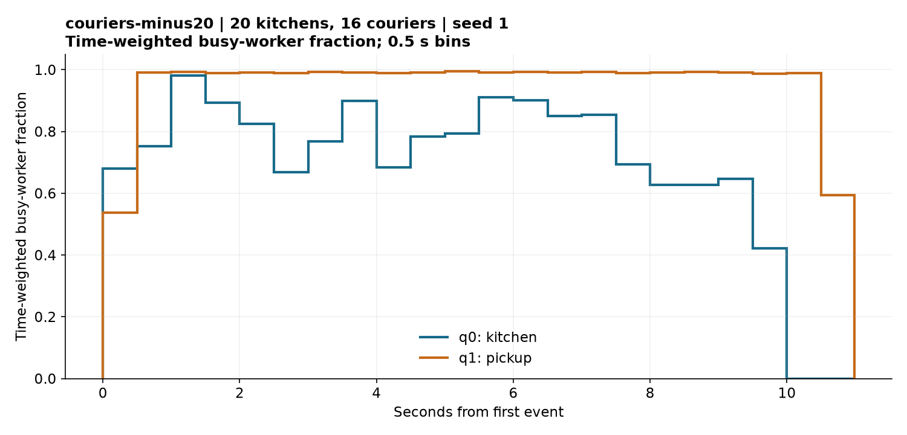
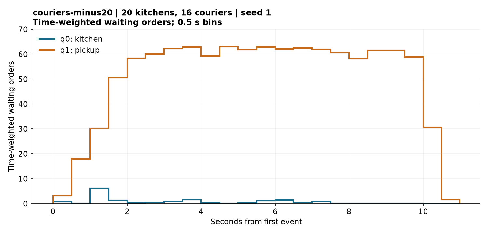
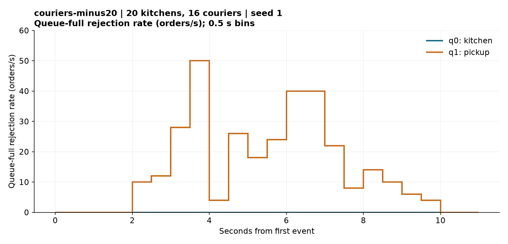
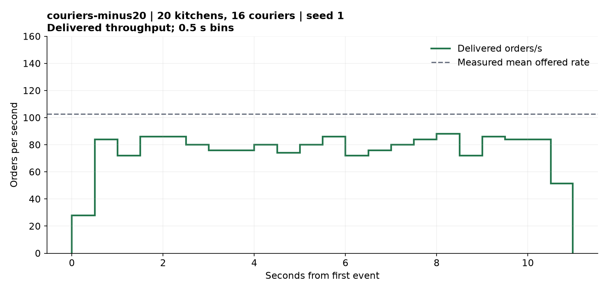
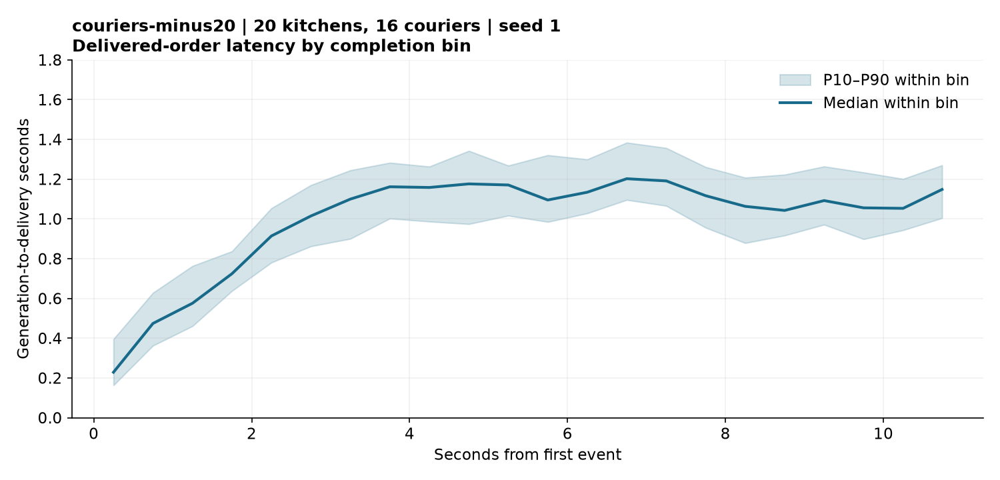
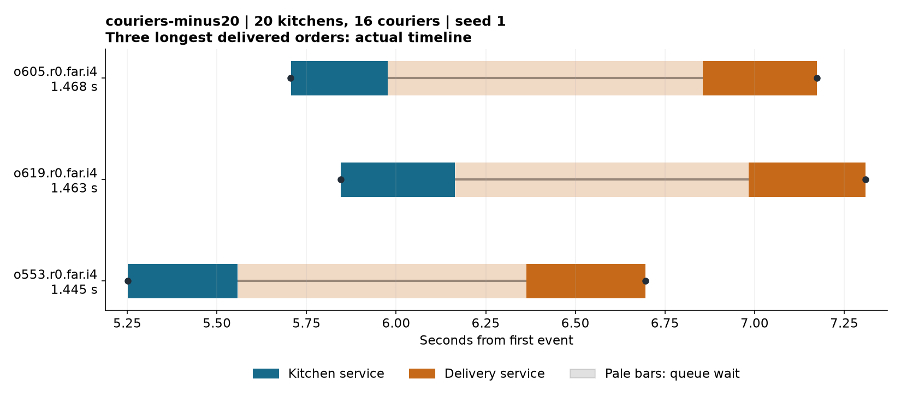

# −20% couriers: six main plots

[Study report](../README.md) · [Methods](../METHODS.md)

20 kitchens, 16 couriers, two 64-slot pending queues. Each of three
runs generated 1,000 orders. The plots below use seed 1, selected before execution.
Seed 1 delivered 842 and dropped 158 orders; its mean
latency was 1.020 s and throughput 76.64 orders/s.
The three-seed means are 0.997 s latency,
76.49 orders/s throughput, and 16.73% loss.

[Plot data](timeseries.csv) · [Longest-order phase breakdown](longest-job-breakdown.csv)
· [Accessory tool command log](tools/commands.log)

Raw evidence: [seed 1](runs/seed-1/) · [seed 2](runs/seed-2/) · [seed 3](runs/seed-3/).
All durations on the main plots are seconds; USE averages are time-weighted.
Most main y-axes share the same scale across sets; trace x-axes focus on selected jobs.

## Utilization: service busy fraction

## Saturation: orders awaiting service

## Errors: queue-full rejection rate

## Delivered throughput

## End-to-end delivered-order latency

## Three longest delivered-order traces

## Accessory tool outputs

[USE plot](tools/use.png) · [System metrics](tools/system.png) · [Visit histogram](tools/visit-hist.png) · [Visit scatter](tools/visit-scatter.png) · [Shared event-trace plot](tools/longest-event-trace.png) · [Pretty trace](tools/longest-jobs-pretty.log).

These supporting plots use their native tool units; see the methods notes.
