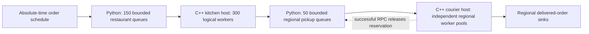
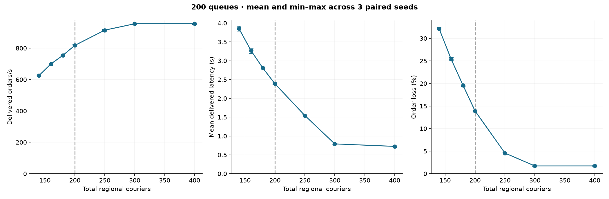

# Large food-delivery study: 200 queues

The full study is **complete on the OU CS Cloud VM `dos8`**: 200 queues,
21 runs, and 2,100,000 orders. The VM audit passed with **1,802,827 delivered,
297,173 rejected, and zero incomplete orders**. No run crossed the configured
P95 injection-lag threshold. The final VM results were imported on November 10,
2026; development pilots are separate and are not included in these results.

Start with the [measured summary](results/summary.md) or
[comparison figure](results/sensitivity-comparison.png). The analysis below uses
the complete three-seed experiment, not the earlier smoke tests.

The system has **150 restaurant kitchen queues (q0–q149)** and **50 regional pickup
queues (q150–q199)**. Restaurants `3r`, `3r+1`, and `3r+2` share region `r`.
Each restaurant has two kitchen workers. Baseline has four couriers per region:
300 kitchen workers + 200 couriers = 500 logical resources, hosted in **two C++
processes**, plus one Python coordinator.

## Measured results and interpretation

The runs used the VM's four CPUs and approximately 8 GiB of RAM, with the same
requested workload paired across seeds 1, 2, and 3. Each scenario generated
100,000 orders per seed. The table reports the mean across the three runs;
P95 is the mean of within-run P95s, not a pooled percentile. Delivered throughput
uses the complete observation interval, including queue drain. Latency excludes
rejected orders, which remain visible in the loss column.

| Scenario | Couriers | Delivered/s | Mean latency (s) | Mean run P95 (s) | Loss (%) | Kitchen rejects/run | Pickup rejects/run |
| --- | ---: | ---: | ---: | ---: | ---: | ---: | ---: |
| baseline | 200 | 817.82 | 2.388 | 5.671 | 13.92 | 1698.3 | 12217.7 |
| couriers-plus25 | 250 | 914.92 | 1.545 | 4.959 | 4.57 | 1713.0 | 2857.0 |
| couriers-plus50 | 300 | 955.58 | 0.791 | 2.750 | 1.72 | 1716.0 | 0.0 |
| couriers-plus100 | 400 | 955.90 | 0.725 | 2.587 | 1.72 | 1721.0 | 0.0 |
| couriers-minus10 | 180 | 754.32 | 2.802 | 5.959 | 19.58 | 1695.0 | 17886.0 |
| couriers-minus20 | 160 | 699.42 | 3.270 | 6.571 | 25.41 | 1692.3 | 23719.3 |
| couriers-minus30 | 140 | 625.59 | 3.852 | 7.135 | 32.14 | 1699.3 | 30442.7 |

**Baseline bottlenecks are concentrated in hot regions.** Across seeds and the
ten highest-demand regions (R0, R5, ..., R45), pickup utilization averages 98.8%
and the waiting population averages 58.6 orders. The ten quietest regions
(R4, R9, ..., R49) average 47.5% utilization and 0.11 waiting orders. Spare
couriers in quiet regions cannot help overloaded regions under this fixed policy.
The busiest restaurant within each hot region (q0, q15, ..., q135) averages 95.7%
kitchen utilization and 24.2 waiting orders. Both tiers therefore contribute to
baseline delay and rejection, consistent with the modeled demand/capacity mismatch.

**Increasing to 300 couriers removes pickup rejections but exposes the kitchen
limit.** Relative to each paired baseline, +50% couriers improves throughput by
16.85% and reduces mean delivered latency by 66.86%. Loss falls from 13.92% to
1.72%. Across the three runs, all **5,148 remaining rejections are at kitchens**;
pickup rejection is zero. Hot pickup waiting falls to 5.06 orders, while hot
kitchen waiting remains 24.7 orders and utilization averages 97.9%.

**Going from 300 to 400 couriers gives little additional throughput.** Throughput
changes from 955.58 to 955.90 orders/s (about 0.03%), and loss stays near 1.72%.
All 5,163 rejections at 400 couriers are again at kitchens. Mean delivered latency
still decreases from 0.791 to 0.725 s (about 8.4%), so the extra fleet does reduce
some waiting, but it does not resolve the observed kitchen bottleneck. This is
evidence of diminishing returns for this workload, not proof that 300 couriers
is universally optimal or that the tiny throughput difference is significant.

**Cuts to the fleet substantially worsen service.** At 140 couriers, throughput
is 23.50% below paired baselines and mean latency is 61.28% higher. Loss reaches
32.14%, including roughly 30,443 pickup rejections per run. The allocation table
below matters: integer reductions affect regions differently, so these results
apply to the specified policy, not every possible placement of the same fleet.

**The longest baseline jobs are dominated by waiting.** In seed 1, the longest
order, `o76439.r45.far.i4`, follows restaurant r45 to region 15 and takes 6.893 s:
2.779 s kitchen wait, 0.295 s preparation, 3.481 s pickup wait, and 0.338 s delivery.
About 90.8% of its latency is queue waiting. The
[phase trace](results/baseline/longest-jobs.png) and local
[phase-duration table](results/baseline/longest-job-breakdown.csv) show this directly.
Sub-microsecond negative transfer remainders in the CSV are floating-point rounding
at millisecond log precision, not negative physical durations.

For this application, the practical next capacity experiment would target hot
kitchens or test regional courier redistribution before increasing every courier
pool again. Neither intervention was measured here. Actual staffing decisions
would also need a latency/loss target and cost model.

## Timing quality and validation scope

Measured offered rates were 996.30–1,006.51 orders/s across all 21 runs. The largest
per-run P95 injection lag was 1.062 ms, below the predeclared 10 ms threshold;
**zero runs were LAGGED**. A rare individual delay reached 0.276 s, so this remains
wall-clock execution with occasional catch-up bursts, not perfect replay. Unlike
the earlier medium experiment, there is no flagged P95 injection-delay confound in
these measurements. Three seeds and their min–max ranges still do not establish
statistical significance, and the different workload scale/backend prevents a
controlled performance comparison against the medium study.

The **full raw-evidence audit ran on the VM** and checked original CSV identity,
routing, phase completeness, drained registries, worker bounds, paired workloads,
metric integration, tool counts, longest-job selection, and PNG integrity. Its
[audit result](results/audit.json) is preserved unchanged. Local import checks
verified byte-identical copying, all 78 PNGs, all 42 required plot paths, and
reconciled 21 run records, 4,200 queue records, and 1,050 region records against
aggregate tables and representative-run time series.

The raw archives remain under `~/food-delivery-lab/analysis/simple/obj-b-food-delivery/large/runs/`
on `dos8`; they were not part of this download. Therefore local import checks are
not a rerun of the full raw-evidence audit. To run `--report` or `validate_study.py`
locally, first copy that complete `runs/` directory, including saved study metadata.
Results CSV/log/JSON files remain local and Git-ignored; PNGs, this analysis, and
`results/summary.md` are commit-ready. No new experiment was run during import.

## Plot index

Each row links the six main seed-1 plots. Objective A accessory figures are in
that scenario's `tools/` directory. The results directory also retains the local
metric CSVs and exact accessory commands.

| Scenario | Utilization | Saturation | Errors | Throughput | Latency | Longest jobs |
| --- | --- | --- | --- | --- | --- | --- |
| baseline | [U](results/baseline/utilization.png) | [S](results/baseline/saturation.png) | [E](results/baseline/errors.png) | [Throughput](results/baseline/throughput.png) | [Latency](results/baseline/latency.png) | [Trace](results/baseline/longest-jobs.png) |
| couriers-plus25 | [U](results/couriers-plus25/utilization.png) | [S](results/couriers-plus25/saturation.png) | [E](results/couriers-plus25/errors.png) | [Throughput](results/couriers-plus25/throughput.png) | [Latency](results/couriers-plus25/latency.png) | [Trace](results/couriers-plus25/longest-jobs.png) |
| couriers-plus50 | [U](results/couriers-plus50/utilization.png) | [S](results/couriers-plus50/saturation.png) | [E](results/couriers-plus50/errors.png) | [Throughput](results/couriers-plus50/throughput.png) | [Latency](results/couriers-plus50/latency.png) | [Trace](results/couriers-plus50/longest-jobs.png) |
| couriers-plus100 | [U](results/couriers-plus100/utilization.png) | [S](results/couriers-plus100/saturation.png) | [E](results/couriers-plus100/errors.png) | [Throughput](results/couriers-plus100/throughput.png) | [Latency](results/couriers-plus100/latency.png) | [Trace](results/couriers-plus100/longest-jobs.png) |
| couriers-minus10 | [U](results/couriers-minus10/utilization.png) | [S](results/couriers-minus10/saturation.png) | [E](results/couriers-minus10/errors.png) | [Throughput](results/couriers-minus10/throughput.png) | [Latency](results/couriers-minus10/latency.png) | [Trace](results/couriers-minus10/longest-jobs.png) |
| couriers-minus20 | [U](results/couriers-minus20/utilization.png) | [S](results/couriers-minus20/saturation.png) | [E](results/couriers-minus20/errors.png) | [Throughput](results/couriers-minus20/throughput.png) | [Latency](results/couriers-minus20/latency.png) | [Trace](results/couriers-minus20/longest-jobs.png) |
| couriers-minus30 | [U](results/couriers-minus30/utilization.png) | [S](results/couriers-minus30/saturation.png) | [E](results/couriers-minus30/errors.png) | [Throughput](results/couriers-minus30/throughput.png) | [Latency](results/couriers-minus30/latency.png) | [Trace](results/couriers-minus30/longest-jobs.png) |

## What is shared, and what stays independent

`implementation/obj-b.food-delivery/run_hosted.py` owns all queue buffers and
courier registries on one asyncio event loop. Each logical worker has a coroutine,
not an operating-system thread. `cpp/host.cpp` implements the existing Objective A
QueueToServer RPC using a completion queue and asynchronous timers. One C++ event
loop per host processes requests and timer completions; gRPC also maintains its own
internal threads. There is no process or sleeping thread per logical resource.
The implementation follows the [C++ asynchronous gRPC API](https://grpc.io/docs/languages/cpp/async/).

Queues retain separate FIFO waiting buffers, worker limits, restaurant allowlists,
and event logs. An RPC's `source_edge` selects its logical queue and `worker-id`
metadata selects its reserved resource. The host rejects unknown routes, wrong
restaurants, duplicate jobs, invalid worker IDs, and a second call to an occupied
worker. Python releases a courier only after the C++ sink write and successful RPC
response. No courier is shared across regions. Transport failures, timeouts, or
host exits fail the entire run; partial runs are retained and never silently reused.
The hosts are terminated and reaped after draining or failure. There are no RPC retries.

The kitchen host returns the completed visit to the coordinator, which admits the
order to its regional pickup buffer. This replaces the medium runner's direct
kitchen-to-pickup RPC. Server departure precedes that coordinator handoff; the
transfer interval remains part of end-to-end latency. The shared coordinator is
itself a possible bottleneck, which injection lag helps identify.

Registry snapshots are written atomically approximately once per second and at
shutdown. In-memory reservations and assignment/release logs are authoritative;
snapshots are inspection aids, not crash-recovery checkpoints. Restarting a failed
run requires a fresh directory. Request deadlines are enforced by the C++ host;
early cancellation or transport failure is handled by aborting the run, not by
attempting to recover ambiguous partial deliveries.

## Workload and sensitivity design

The default is **100,000 orders × 3 paired seeds × 7 scenarios = 2.1 million orders**.
Each same-seed scenario uses the same requested arrival schedule, restaurant IDs,
and service attributes. Run order is reproducibly shuffled within seed blocks,
with the first baseline first. A run includes startup, generation, and full drain;
reported service metrics exclude process startup.

- Exponential requested gaps: 0.0005 model seconds × `time_scale=2`, or a mean
  **1 ms real gap / 1,000 orders per second**.
- Items are uniform 1–4; preparation is uniform 0.02–0.04 model seconds per item.
  Mean real preparation time is **0.15 s**, giving 13.33 orders/s per two-worker kitchen.
- near/mid/far are uniform, with multipliers 1/2/3. Delivery is uniform
  0.04–0.06 model seconds × multiplier × 2. Mean delivery is **0.20 s**,
  giving 20 orders/s per four-courier region.
- Regional demand weights repeat `3, 2.5, 2, 1.5, 1` across ten groups of five
  regions. They sum to 100, so each region receives 1–3% of orders.
  Its three restaurants receive 50%, 30%, and 20% of its demand.
- Restaurant waiting capacity is 32; pickup waiting capacity is 64. A full buffer
  rejects the incoming order and records `ERROR QUEUE-FULL`. Pickup rejection
  wastes completed preparation. Service reservations are separate from buffers.

Hot regions receive roughly 30 orders/s against baseline capacity 20/s; their
busiest restaurant receives roughly 15/s against kitchen capacity 13.33/s.
This predicts both pickup and kitchen bottlenecks, which the measured USE and
rejection locations above support. These are synthetic wall-clock waits, not measured food delivery times.

| Scenario | Total couriers | Allocation across regions | Total logical workers |
| --- | ---: | --- | ---: |
| baseline | 200 | 4 each | 500 |
| couriers-plus25 | 250 | 5 each | 550 |
| couriers-plus50 | 300 | 6 each | 600 |
| couriers-plus100 | 400 | 8 each | 700 |
| couriers-minus10 | 180 | 4 in R0–R29; 3 in R30–R49 | 480 |
| couriers-minus20 | 160 | 4 in R0–R9; 3 in R10–R49 | 460 |
| couriers-minus30 | 140 | 3 in R0–R39; 2 in R40–R49 | 440 |

Percentages apply to the **courier fleet**, not all workers. Reductions use equal
integer quotas with remaining workers assigned by increasing region ID. This is
fixed allocation, not dynamic dispatch between regions or an optimized fleet.

## Arrival timing and interpretation

The coordinator prepares seeded arrival offsets before services start and schedules
injection against a monotonic absolute start time. Per-order work does not add to
every requested interarrival gap. Late orders are injected as soon as possible;
this can form catch-up bursts, so absolute scheduling is not a guarantee of exact
arrival replay. `planned-arrivals.csv` and `arrival-lag.csv` preserve the evidence.

The collector marks a run **LAGGED** when its P95 injection delay exceeds 10 ms.
The threshold is specified before collection in `study.json`. Such runs remain
visible in summary tables. Inspect those and host resource usage before attributing
a throughput or loss difference solely to fleet size. Run only one experiment at
a time on the VM. The hosted backend, timing policy, and workload scale differ
from the medium study, so the two studies are not a controlled backend benchmark.

## Plots and evidence

For each scenario, seed 1 supplies the six main figures: utilization, saturation,
errors, throughput, latency, and event traces for the three longest delivered jobs.
The full study produces **42 main plots**. Aggregate tables use all three seeds.

All 200 queues appear as rows in the USE heatmaps, with sparse labels for legibility.
Main USE uses time-weighted event-state integration in one-second bins. Errors
count actual rejection impulses. Global throughput and delivered-order latency
are shown alongside a readable regional sample, R0–R4; CSV metrics retain all
50 regions. Latency excludes rejected orders, which are reported separately.
Worker utilization spans server entry to exit, not RPC return overhead. Waiting
includes reserved/in-flight visits and can briefly exceed pending-buffer capacity.

All ten Objective A accessory tools are demonstrated. Shared USE uses uniform
100 ms state samples (10/100/1000 rows mean 1/10/100 seconds), with the first five
pickup queues in its supporting plot. Native event/system latency is in ms;
main plots use seconds. Final partial throughput bins use their actual duration.
Error bars show seed min–max, not confidence intervals. Longest-job selection is
based on complete delivered end-to-end latency, with queue wait and service shown
for the actual restaurant and pickup route.

Like the matchmaking study, **commit scripts, `study.json`, notes, and PNGs**.
Raw `runs/` and generated CSV/log/JSON under `results/` stay local and are ignored.
`results/summary.md` contains the completed VM measurements.
The `--archive` action verifies every raw member before replacing its folder with
`runs/<scenario>/seed-N.tar.gz`. Reporting and validation read either format.

Useful local outputs include `metrics-by-run.csv`, `metrics-by-queue.csv`,
`metrics-by-region.csv`, `comparison.csv`, `plot-manifest.csv`, `validation.json`,
and `audit.json`. Each run includes its configuration, sources, sinks, event logs,
normalized Objective A inputs, registry snapshots, arrival timing, process IDs,
and final status. Hashes compare requested schedules and service attributes across
paired scenarios. Original small and medium study evidence is not regenerated.

## VM commands

See [VM.md](VM.md) for the exact build, smoke-test, tmux, collection, and download
commands. Use Python 3.11+; the prepared VM has Python 3.14. A full seed's source
schedule is approximately 100 seconds per scenario before drain and analysis.
Total runtime and peak memory must be measured on the VM, not inferred from the
short local pilots. Default timeout is 600 seconds per run; analysis occurs after
the hosts stop and outside that deadline.

## Implementation verification

Local development validation passed all **34 application tests**, including the
new hosted protocol/isolation/deadline tests and a 200-queue integration test.
A separate 5,000-order baseline smoke run and seven 10,000-order pilots exercised
collection, six-plot reporting, all ten accessory tools, verified archival, and
archived-run resume. The seven pilots accounted for 66,791 delivered and 3,209
rejected orders (70,000 total, zero incomplete); all 42 pilot plots passed audit.
One pilot was flagged LAGGED. These are development checks on the Mac, not VM
capacity measurements or the final 100,000-order/three-seed experiment.
