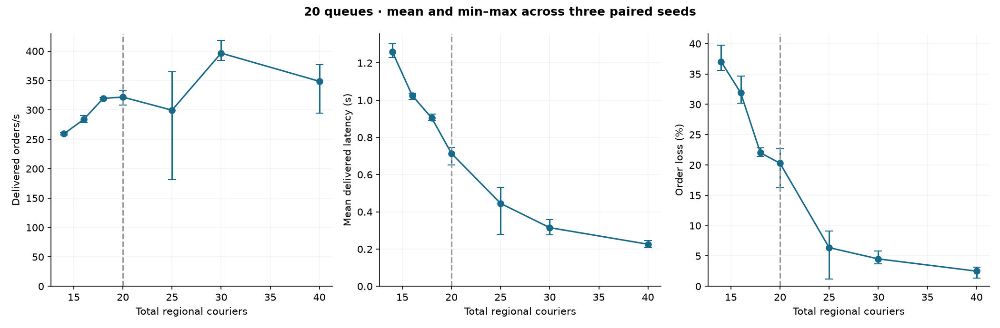

# Medium food-delivery study: 20 queues

Fifteen restaurant kitchen queues feed five regional pickup queues. Thirty
kitchen workers stay fixed while seven scenarios change regional courier counts.
Couriers serve only their own region, so spare capacity elsewhere cannot clear
a busy region's backlog.

Completed **21 runs, 210,000 orders, and 42 main plots**: 172,609 delivered,
37,391 rejected, and none incomplete. Each scenario uses three seeds and 10,000
orders per run; galleries show seed 1.

## Results

The table reports three-seed means. Latency includes delivered orders only;
resource changes apply to couriers, not all workers.

| Set / plot gallery | Regional couriers | Delivered orders/s | Mean latency (s) | Loss (%) | Measured offered orders/s |
| --- | --- | ---: | ---: | ---: | ---: |
| [baseline](results/baseline/README.md) | 4 / 4 / 4 / 4 / 4 | 321.85 | 0.714 | 20.29 | 428.39 |
| [couriers-plus25](results/couriers-plus25/README.md) | 5 / 5 / 5 / 5 / 5 | 299.56 | 0.445 | 6.37 | 336.54 |
| [couriers-plus50](results/couriers-plus50/README.md) | 6 / 6 / 6 / 6 / 6 | 396.63 | 0.315 | 4.52 | 430.00 |
| [couriers-plus100](results/couriers-plus100/README.md) | 8 / 8 / 8 / 8 / 8 | 348.71 | 0.226 | 2.50 | 368.18 |
| [couriers-minus10](results/couriers-minus10/README.md) | 4 / 4 / 4 / 3 / 3 | 319.68 | 0.904 | 22.02 | 434.05 |
| [couriers-minus20](results/couriers-minus20/README.md) | 4 / 3 / 3 / 3 / 3 | 283.66 | 1.026 | 31.89 | 448.46 |
| [couriers-minus30](results/couriers-minus30/README.md) | 3 / 3 / 3 / 3 / 2 | 259.39 | 1.259 | 37.05 | 445.89 |



The baseline has both kitchen and regional pickup bottlenecks. Adding couriers
reduces pickup congestion: at +50%, latency falls from 0.714 to 0.315 seconds
and loss from 20.29% to 4.52%. At +100%, pickup rejections disappear, but kitchen
rejections remain. Cutting couriers increases waits and losses.

The longest baseline order took 1.879 seconds, about 94% of it waiting in queues.
See the [event trace](results/baseline/longest-jobs.png).

**Arrival rates varied substantially**, so these are not controlled fleet-size
comparisons. In particular, +25% seed 3 offered only 186.95 orders/s. Lower
throughput in some larger-fleet scenarios does not mean extra couriers reduce
capacity; their offered load was also lower. Seed ranges are not confidence intervals.

## Plots and reproduction

Each gallery above has utilization, saturation, errors, throughput, latency, and
longest-job traces. `tools/` holds Objective A accessory outputs.
[METHODS.md](METHODS.md) explains the model, architecture, workload, and commands;
[study.json](study.json) specifies regional allocations and seeds.

With the application's virtual environment active, from the repository root:

```bash
python analysis/simple/obj-b-food-delivery/medium/run_study.py --report
python analysis/simple/obj-b-food-delivery/medium/validate_study.py
```

Reporting and auditing require saved raw folders or archives. Collection uses
`--collect --report` and checks existing input fingerprints before reusing runs.
Scripts, notes, and PNGs are tracked; raw `runs/` and generated CSV/log/JSON files
stay local. The audit checks accounting, routing, worker bounds, metrics, and plots.
