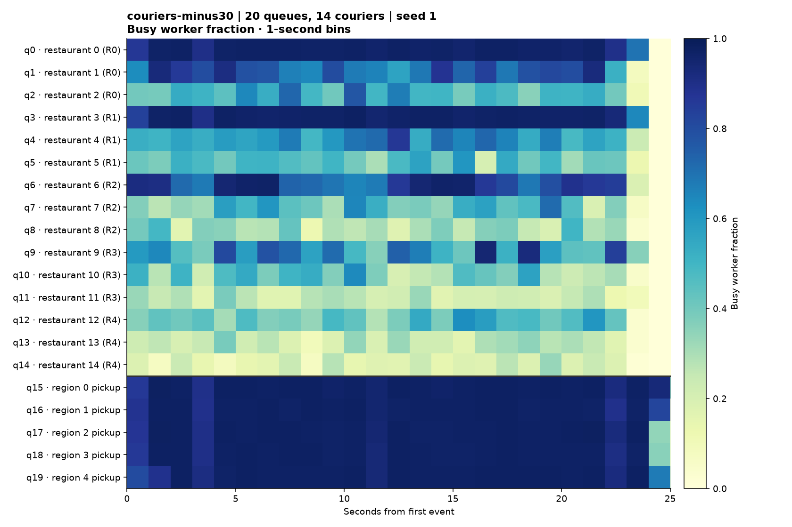
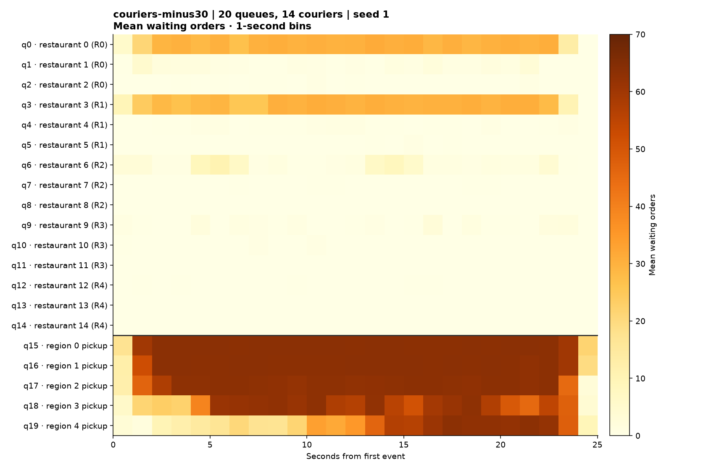
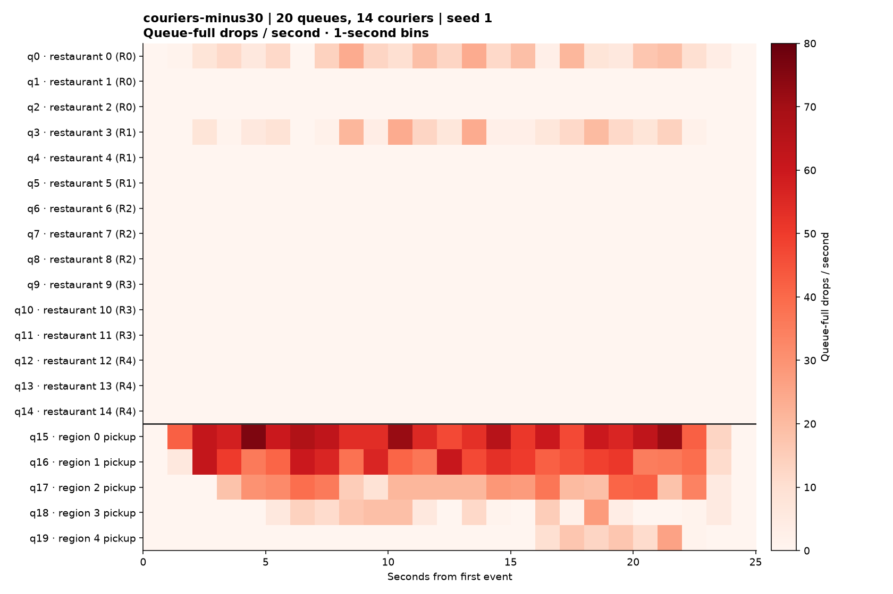
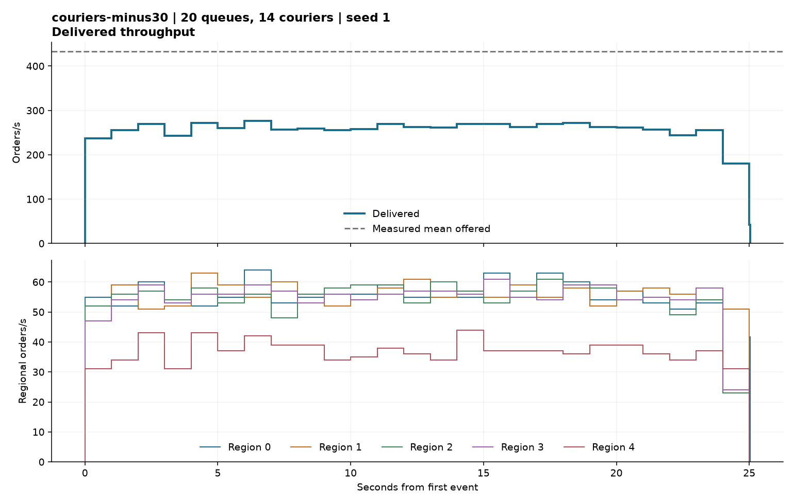
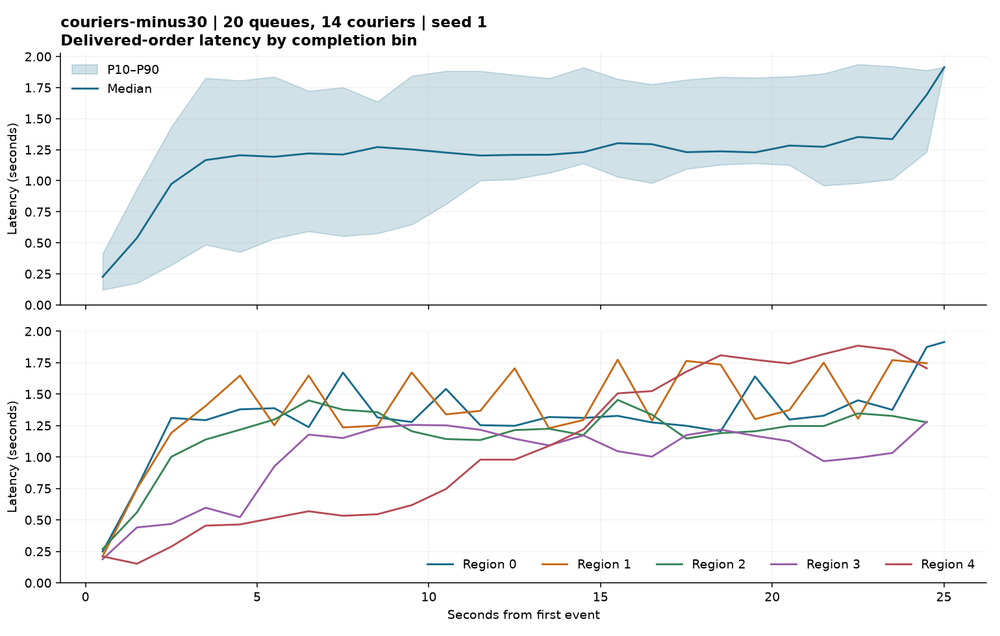
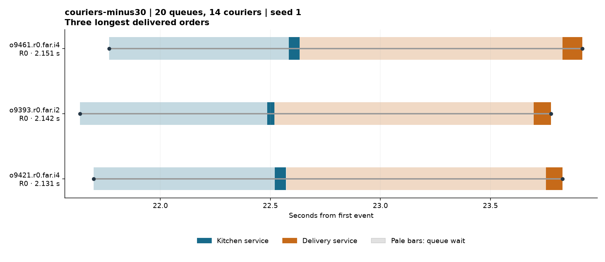

# couriers-minus30: six main plots

[Study results and caveats](../../README.md) · [Methods](../../METHODS.md)

20 queues; regional courier allocation **3 / 3 / 3 / 3 / 2**.
These six plots show preselected seed 1 (10,000 orders). Aggregate results use
seeds 1–3, including the arrival-rate variation discussed in the study report.

## Utilization

## Saturation

## Errors

## Throughput

## Latency

## Longest-job event traces

## Supporting evidence

[Queue time series](queue-timeseries.csv) · [System time series](system-timeseries.csv)
· [Longest orders](longest-jobs.csv) · [Phase durations](longest-job-breakdown.csv)
· [Accessory-tool commands](tools/commands.log)

Raw runs: [seed 1](../../runs/couriers-minus30/seed-1.tar.gz), [seed 2](../../runs/couriers-minus30/seed-2.tar.gz),
[seed 3](../../runs/couriers-minus30/seed-3.tar.gz). Each archive contains all logs and analysis inputs.
