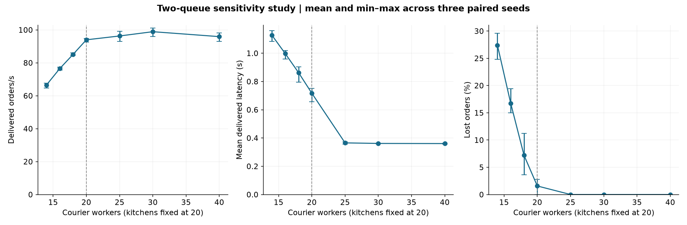

# Small food-delivery study: 2 queues

One kitchen queue feeds one pickup queue. Kitchen workers stay fixed at 20;
seven scenarios vary courier capacity. The objective is to reduce waiting and
loss while delivering more orders with a reasonable worker count.

Completed **21 runs, 21,000 orders, and 42 main plots**: 19,413 delivered,
1,587 rejected, and none incomplete. Each scenario uses three seeds and 1,000
orders per run; its plot gallery shows seed 1.

## Results

The table reports three-seed means. Latency includes delivered orders only.

| Scenario | Couriers | Delivered orders/s | Mean latency (s) | Loss (%) |
| --- | ---: | ---: | ---: | ---: |
| [Baseline](results/baseline/README.md) | 20 | 93.97 | 0.717 | 1.57 |
| [+25% couriers](results/couriers-plus25/README.md) | 25 | 96.30 | 0.365 | 0.00 |
| [+50% couriers](results/couriers-plus50/README.md) | 30 | 98.90 | 0.362 | 0.00 |
| [+100% couriers](results/couriers-plus100/README.md) | 40 | 95.91 | 0.361 | 0.00 |
| [−10% couriers](results/couriers-minus10/README.md) | 18 | 85.10 | 0.863 | 7.20 |
| [−20% couriers](results/couriers-minus20/README.md) | 16 | 76.49 | 0.997 | 16.73 |
| [−30% couriers](results/couriers-minus30/README.md) | 14 | 66.52 | 1.127 | 27.40 |



The baseline bottleneck is courier capacity: utilization averages 94%, with
33.55 orders waiting at pickup. All rejections occurred at pickup. Increasing
from 20 to 25 couriers roughly halved latency and eliminated observed losses;
30 or 40 couriers provided little further benefit at this load.

The longest baseline order took 1.220 seconds, including 0.564 seconds waiting
for pickup. See its [event trace](results/baseline/longest-jobs.png).
Twenty-five couriers is a useful tested configuration, not a proven optimum.
Actual offered rates varied around 101–105 orders/s, and the three-seed ranges
are not confidence intervals.

## Plots and reproduction

Each scenario gallery above contains utilization, saturation, errors, throughput,
latency, and longest-job traces. Its `tools/` folder contains Objective A accessory
outputs. [METHODS.md](METHODS.md) contains the architecture, workload decisions,
metric definitions, and collection instructions; [study.json](study.json) holds settings.

After [building the C++ application](../../../../implementation/obj-b.food-delivery/cpp/README.md),
activate its virtual environment and run from the repository root:

```bash
python analysis/simple/obj-b-food-delivery/small/run_study.py --report
python analysis/simple/obj-b-food-delivery/small/validate_study.py
```

Reporting and auditing need saved raw runs. Use `--collect --report` to collect
runs when inputs match; changed collection inputs require a separate experiment.
Scripts, notes, and PNGs are tracked; raw `runs/` and generated CSV/log/JSON files
stay local. The audit reconciles every generated order with delivery or rejection.
