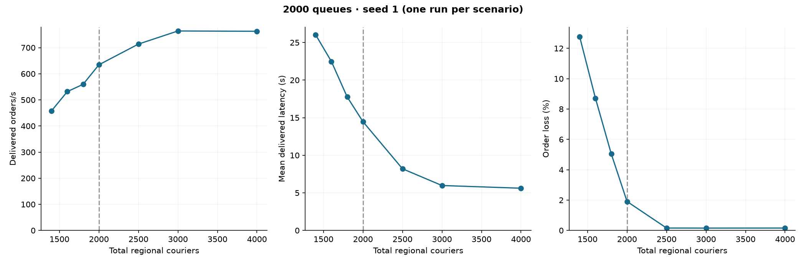

# Very-large food-delivery study: 2,000 queues

Completed **seven scenarios with seed 1**, using 100,000 orders each:
**700,000 orders, 671,082 delivered, 28,918 rejected, and zero incomplete**.
The study includes 42 main plots and passed the saved-evidence audit.

## Model and workload

1,500 restaurant kitchen queues feed 500 regional pickup queues. Two C++ hosts
execute service work; a Python coordinator maintains independent queues and
courier reservations. Kitchens have 3,000 workers in every scenario.

Requested arrivals average 1,000 orders/s, with mean preparation/delivery times
of 1.5/2 s. Regional demand is uneven, and couriers cannot cross regions.
Kitchen/pickup buffers hold 32/64 waiting orders. Scenarios share the requested
workload and vary only courier counts; [study.json](study.json) records settings.
Service times are scaled tenfold from the large study, so latency is not directly
comparable between the two sizes.

## Results

Throughput includes draining. Latency covers delivered orders only.
Each scenario links to its six main plots and Objective A accessory outputs.

| Scenario | Couriers | Delivered/s | Mean latency (s) | Loss (%) |
| --- | ---: | ---: | ---: | ---: |
| [baseline](results/baseline/) | 2,000 | 634.44 | 14.467 | 1.91 |
| [couriers-plus25](results/couriers-plus25/) | 2,500 | 713.70 | 8.201 | 0.16 |
| [couriers-plus50](results/couriers-plus50/) | 3,000 | 763.92 | 5.974 | 0.15 |
| [couriers-plus100](results/couriers-plus100/) | 4,000 | 762.74 | 5.615 | 0.16 |
| [couriers-minus10](results/couriers-minus10/) | 1,800 | 559.67 | 17.763 | 5.05 |
| [couriers-minus20](results/couriers-minus20/) | 1,600 | 531.71 | 22.483 | 8.72 |
| [couriers-minus30](results/couriers-minus30/) | 1,400 | 457.95 | 26.045 | 12.78 |

At **3,000 couriers (+50%)**, throughput improves 20.4% and mean latency falls
58.7% from baseline. Pickup rejections disappear; all 154 remaining rejections
occur at kitchens. Increasing to 4,000 couriers adds little throughput, while
cutting to 1,400 raises loss to 12.78%. Busy kitchens or courier redistribution
are useful next experiments; these results do not establish an optimal fleet.

The [longest baseline order](results/baseline/longest-jobs.png) takes 63.546 s,
with **93.2% spent waiting** for kitchen or courier service.

## Interpretation and evidence

The six main plots show utilization, saturation, errors, throughput, latency,
and longest-job traces. USE uses time-weighted states across all 2,000 queues;
regional line panels show R0–R4. Accessory states are sampled every second.

Only one seed was used, so there is no run-to-run uncertainty estimate.
Maximum run P95 injection lag was 7.59 ms, below the 10 ms threshold, but the
−20% run had an individual delay of 2.458 s. Catch-up bursts may affect that result.
These are finite-workload observations, not proof of steady-state performance.

See the [summary](results/summary.md), [comparison data](results/comparison.csv),
and [audit record](results/audit.json). The imported results were checked against
7 run records, 14,000 queue records, 3,500 region records, and 78 PNGs.
Raw logs are not included in this results-only copy; regenerating plots or
repeating the full audit requires the original `runs/` directory.
