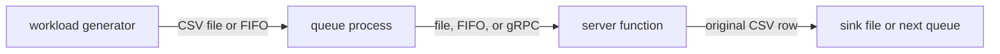

# Objective A framework

This directory is the shared queue framework for Lab 1: a wall-clock workload of wait-task jobs, a dropping queue, and server functions that sleep those waits and log the Lab 0 event vocabulary. Later analysis tools and each person's application sit on this path. `example_code/` is the course template and is left unchanged. These programs are the copies that actually log and forward jobs.

A job is one CSV row. Each task is a sleep in seconds (`W`), not a discrete simulator step. The queue does not sleep. The server function does.

## How a job moves



1. The generator writes a header, then one flushed row per job. Before each row, including the first, it sleeps a draw from `--arrival-dist`. Each task's `W` is an independent draw from `--wait-dist`.
2. The queue reads those rows. A job that fits in `--qsize` is buffered and logged `ARRIVE-VIA`. A job that does not fit is logged `ERROR QUEUE-FULL` and dropped. The producer does not block.
3. A consumer thread takes the job off the buffer. That is the moment it disappears from `metric-q-size`. The consumer writes the original line to an outfile, or calls gRPC `Submit` on a peer.
4. The server function logs `ENTERS-SERVER`, sleeps each `W` in order (`TASK-START` then `TASK-END`), logs `EXITS-SERVER`, and picks one outgoing edge at random. It forwards `raw_line` unchanged, so the next queue can parse the same tasks.

File and FIFO edges are the default. `--ingrpc` and `--outgrpc` add an RPC edge. A queue may mix files and RPC on the same process. A server function has one input, either `--infile` or `--ingrpc`.

## How logs are shaped

Each process uses the course prefix, then a Lab 0 body:

```text
2026-10-20 17:00:00,123 - Q_pid1234@host - INFO - 1760990100.123 j0 IN q0 ARRIVE-VIA jobs.csv
```

The body is `{wall-clock seconds} {job id} IN {qid} {KIND} ...`. The time token has three decimal places and comes from `time.time()` when the event is logged, so the sleep sits between `TASK-START` and `TASK-END`. Task completion is named `TASK-END`, which is Lab 0's spelling. Edge labels are a filename basename or `host:port`. Later tools should strip the prefix and keep the body. `metric-q-size` and `state-visits` are operational lines, not Lab 0 events.

## Where to read next

| Piece | How it fits | Read |
| --- | --- | --- |
| Shared job, event, visit, and gRPC code | Imported by the scripts below. No install step. | [lib/README.md](lib/README.md) |
| Workload generator | Produces the CSV. Does not speak gRPC. | [workload-generator/README.md](workload-generator/README.md) |
| Queue | Buffer, drop-on-full, file and RPC edges. | [queue/README.md](queue/README.md) |
| Stateless server function | Sleeps the waits and forwards the row. | [server-func-stateless/README.md](server-func-stateless/README.md) |
| Stateful server function | Same visit, plus an in-process visit count. | [server-func-stateful/README.md](server-func-stateful/README.md) |
| Optional gRPC | Protos, flags, startup order, backpressure. | [proto/README.md](proto/README.md) |
| `filter-by-queue` | Keep one queue's metric rows. | [filter-by-queue/README.md](filter-by-queue/README.md) |
| `filter-by-job` | Keep one job's event lines. | [filter-by-job/README.md](filter-by-job/README.md) |
| `compute-use` / `plot-use` | Utilization, saturation, errors. | [compute-use/README.md](compute-use/README.md) |
| `derive-sys-metrics` / `plot-sys-metrics` | Throughput and end-to-end latency. | [derive-sys-metrics/README.md](derive-sys-metrics/README.md) |
| `derive-event-metrics` / `plot-derive-event-metrics` | Per-visit response. | [derive-event-metrics/README.md](derive-event-metrics/README.md) |
| `create-event-trace` | Gantt of job lifelines. | [create-event-trace/README.md](create-event-trace/README.md) |
| `pretty-print-job-trace` | Readable job timeline. | [pretty-print-job-trace/README.md](pretty-print-job-trace/README.md) |
| Large-model mock-ups | Three queues, both server functions, gRPC and FIFO. | [mockups/large-model/README.md](mockups/large-model/README.md) |
| Sanity check | Medium wait-job scale study: 100 queues, seven server sets, figures. | [sanity-check/README.md](sanity-check/README.md) |

Python dependencies for an RPC edge are listed in [requirements.txt](requirements.txt). The file-only path does not import them.

## File demo

This works in PowerShell. The queue finishes the file before the server function starts, so nothing has to stay running.

```text
python implementation/obj-a/workload-generator/workload_generator.py --arrival-dist fixed --arrival-fixed 0 --wait-dist fixed --wait-fixed 0.05 --count 5 --out jobs.csv
python implementation/obj-a/queue/queue.py --qsize 10 -i jobs.csv -o queued.csv --logfile q.log
python implementation/obj-a/server-func-stateless/server_func.py -i queued.csv -o sink.csv --logfile sf.log
```

`q.log` should show one `ARRIVE-VIA` and one `DEPART-VIA` per job, plus `metric-q-size`. `sf.log` should show `ENTERS-SERVER`, a `TASK-START` / `TASK-END` pair, `EXITS-SERVER`, and `DEPART-VIA` per job. `sink.csv` should contain the same job rows the generator wrote.

A live FIFO needs the reader open before the writer. Start the server function, then the queue. The steps are in the [queue README](queue/README.md). gRPC uses that same order (listener first). The commands are in the [proto README](proto/README.md).

## Tests

From the repository root:

```text
python -m unittest discover -s implementation/obj-a/tests -v
```

| File | What a pass means |
| --- | --- |
| `tests/test_job.py` | CSV quoting round-trips, the header is skipped, and a bad row raises. |
| `tests/test_events.py` | Each Lab 0 kind is one exact line, including `QUEUE-FULL` and `NO-OUT-EDGE`. |
| `tests/test_generator.py` | `--count 3` writes a header plus three jobs; duration can stop during the arrival sleep; count wins when both limits are set. |
| `tests/test_queue.py` | A free slot logs `ARRIVE-VIA` and keeps that job. A full buffer logs `QUEUE-FULL` for the dropped job only. A gRPC sender logs `DEPART-VIA` on reject and skips it on transport failure. |
| `tests/test_server.py` | The visit sleeps each wait in order, forwards `raw_line`, logs `NO-OUT-EDGE` when there is no edge, and still finishes the visit when a gRPC send fails. |
| `tests/test_grpc_spec.py` | Listen flags require `host:port`. A queue's default dial calls a server function. A server function's dial calls a queue. |
| `tests/test_grpc_loopback.py` | A real localhost `Submit` accepts `j0`, drops `j1` when the buffer holds one job, and a server function forwards the original row. Skipped when grpcio is not installed. |
| `tests/test_smoke.py` | Generator, queue, and stateless server function as three processes. Two jobs, two of each event, queue id `q0`, server id `0`, no `QUEUE-FULL`, sink rows equal generated rows. |

The gRPC listen-until-Ctrl-C path is not a subprocess test, because that process is meant to stay up. The loopback test covers the RPC itself.
