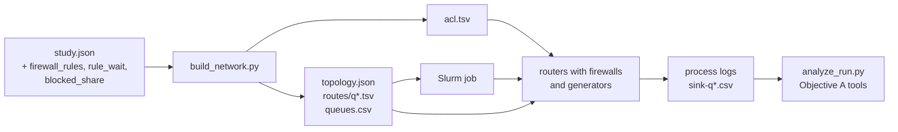
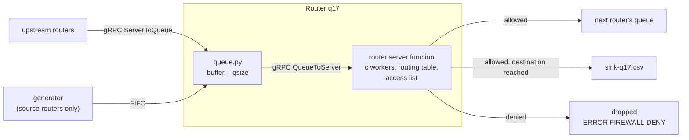
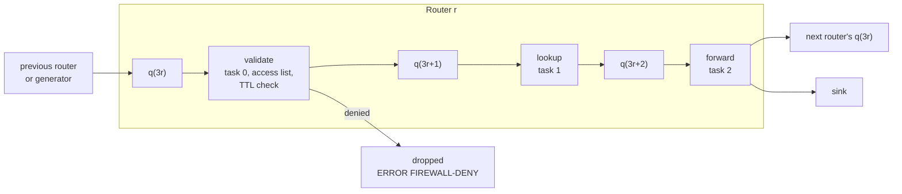
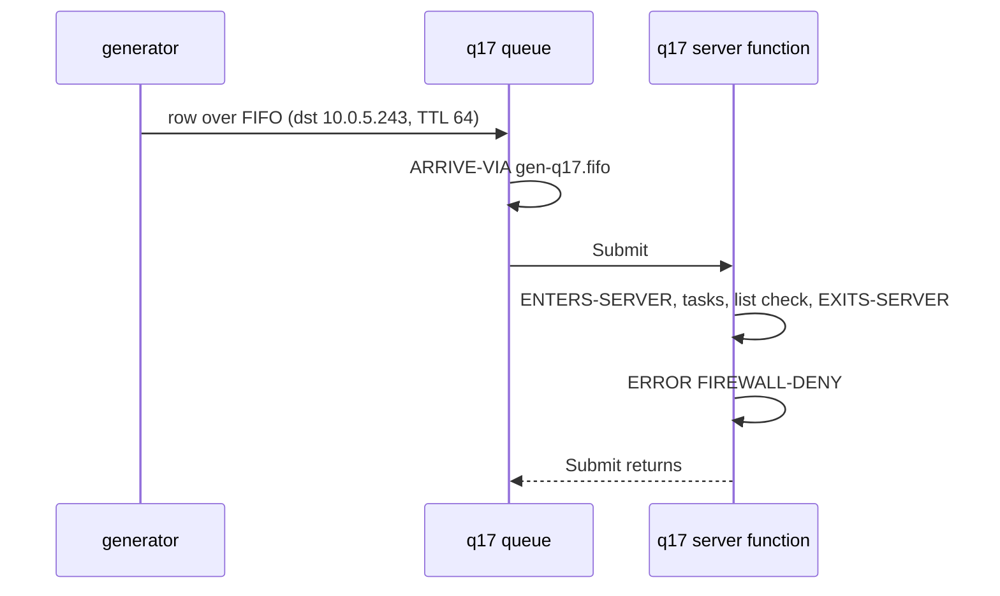

# Architecture

This is the design for the firewalled packet routing application. The problem and the queueing model are in [README.md](README.md). It is the [packet routing architecture](../obj-b.packets/architecture.md) with a firewall added, so this document covers only what the firewall changes. Everything here is implemented and tested locally. The Slurm jobs reuse the packet routing ones and have not run on Sooner yet.

## Overview

The pipeline is the packet routing one. The spec gains three settings, the build tool writes one more file, the access list, and the router server functions read it.



Every router reads the same access list. A spec without `firewall_rules` builds and runs exactly as the packet routing network does, so both applications share one code base.

## One router

A router is still one `queue.py` and one server function. The firewall is part of the server function, not a separate queue: checking the list is work the router does on each packet, so it belongs in the visit and occupies a server. `fw/router.py` is the packet routing router with the check added through two hooks in its visit, and `server_func.py` starts it.



One visit runs in this order. Steps 2 and 4 are new:

1. Log `ENTERS-SERVER`, and sleep each task's `W` between `TASK-START` and `TASK-END`.
2. Check `dst_ip` against the access list, first match wins, and sleep `rule_wait` for each rule checked.
3. Log `EXITS-SERVER`.
4. If the list denied the packet, log `ERROR FIREWALL-DENY` and drop it.
5. Continue as in the [packet routing visit](../obj-b.packets/architecture.md#one-router): the TTL check, the lookup, then delivery or forwarding.

The check sleeps inside the visit, between `ENTERS-SERVER` and `EXITS-SERVER`, so `time-in-service` and the queue's busy servers include it. The match itself is a short loop in Python. The sleep stands for its cost, as the task waits stand for the routing work, so changing `rule_wait` changes the cost without changing the CPU the processes use.

The firewall checks before the TTL. A packet the list denies is dropped for that reason, even if its TTL has also run out.

## Decomposing a router

In the [decomposed router](../obj-b.packets/architecture.md#decomposing-a-router), the validate stage checks the list:



Validate is where a router decides whether a packet is acceptable, so the check fits there. A denied packet never reaches lookup or forward, which saves their work. The validate stage's service time becomes $W_0 + N r$. With the starting values, that is 5 ms + 10 ms, as long as the lookup stage.

## The access list

`acl.tsv` has one rule per line: an address, a mask, and an action, separated by tabs.

```text
# acl.tsv: address, mask, action. First match wins. No match allows.
10.255.0.0	255.255.255.255	deny
10.255.0.1	255.255.255.255	deny
...
10.0.0.240	255.0.0.240	deny
```

A packet matches a rule when `dst_ip & mask == address & mask`. A prefix like `/28` is the mask `255.255.255.240`. A mask may also have gaps, as in Cisco wildcard masks. `255.0.0.240` matches any `10.x.y.240` to `10.x.y.255`, the blocked hosts in every router's `/24`, with one rule.

The build tool writes $N$ rules from `firewall_rules`:

- **$N - 1$ filler rules** deny single addresses in `10.255.0.0/16`. No router owns that range in a network of fewer than 65,280 routers, so no packet matches them. They make the list long.
- **The blocking rule** comes last.

So every packet checks all $N$ rules, and every visit with a firewall costs exactly $N \cdot r$. That keeps the predicted load exact. A list with frequently matched rules near the top would cost less on average, and the format allows that, but these studies don't use it.

## A packet's journey

An allowed packet travels as in the packet routing network, paying $N r$ more at every router. A denied packet ends at its first router:



The packet never gets a `DEPART-VIA`, so the analysis counts it as never delivered, as it does a packet dropped for `TTL-EXPIRED`.

## The spec

A study file is a [packet routing study file](../../analysis/obj-b-packets/README.md#defining-a-model) with three more fields:

| Field | Meaning | Starting value |
| --- | --- | --- |
| `firewall_rules` | $N$, the length of the list. Absent or 0 means no firewall. | 50 |
| `rule_wait` | $r$, seconds per rule checked | 0.0002 |
| `blocked_share` | $p$, the share of each generator's packets sent to blocked hosts | 0.1 |

The large and very large packet routing models scale every service time by 2 and 5. Their firewall studies scale `rule_wait` the same way, to 0.0004 and 0.001 s, so the list adds the same share of work at every scale.

## Traffic

The generator gains one option, `--blocked-share p`. For each packet it draws the destination router as before. Then, with probability $p$, it picks a host from .240 to .254, which the list blocks. Otherwise it picks one from .1 to .239. Without the option, it draws hosts from .1 to .254 exactly as before, so the packet routing studies' traffic doesn't change.

Destinations and blocking are drawn from the generator's existing attribute stream, so a traffic seed still gives the same packets every time.

## Predicted load

The study planner predicts each queue's utilization before a run and sets the arrival rate so the busiest queue reaches the target. With the firewall it uses the formula from the [README](README.md#mapping-to-queues). For router $r$ with $v_r$ visits per allowed packet and a share $s_r$ of the sources:

| Queue | Packets per offered packet | Service time |
| --- | --- | --- |
| Monolith | $(1 - p)\, v_r + p\, s_r$ | $W_0 + W_1 + W_2 + N r$ |
| Validate stage | $(1 - p)\, v_r + p\, s_r$ | $W_0 + N r$ |
| Lookup and forward stages | $(1 - p)\, v_r$ | $W_1$ and $W_2$ |

Servers are still split by visits per allowed packet. The budget then follows the routing load, and source routers carry the extra load of unwanted traffic. That is the effect the study measures.

## Running every scale

The four models reuse the packet routing study tooling:

| Model | Routers | Queues | Processes | Packets per run | Node |
| --- | ---: | ---: | ---: | ---: | --- |
| Simple | 10 | 10 | 23 | 5,000 | This VM, or Sooner `normal` |
| Medium | 200 | 200 | 420 | 10,000 | Sooner `normal`, 32 cores, 64 GB |
| Large | 1,000 | 1,000 | 2,100 | 100,000 | Sooner `normal`, 64 cores, 200 GB |
| Very large | 3,400 | 10,200 | 20,740 | 100,000 | Sooner `largemem`, 56 cores, about 2 TB |

The process counts and resources are the packet routing ones. The firewall adds no processes, and a 50-rule list is a few kilobytes per process.

The study files go in `analysis/obj-b-firewall/MODEL/`, each with its `study.json` and `run.sbatch`. The shared `run_study.py` and `sooner/job.sh` in `analysis/obj-b-packets/` accept a model folder under `analysis/`, such as `obj-b-firewall/medium`. They pack raw logs into `/scratch/$USER/obj-b-firewall-MODEL/JOBID/`, so they don't mix with the packet routing archives.

## Logs and metrics

`FIREWALL-DENY` is a new error kind, written with the existing `format_event`, so the log format doesn't change. The analysis tools act only on `QUEUE-FULL` among error kinds. Denials therefore don't count as congestion in `compute-use` or the USE plots, which is the separation the [README](README.md#interpreting-the-metrics) asks for.

Three places count denials:

- **`fw/extension.py`** adds `FIREWALL-DENY` to the ways a packet can end in `run_local.py`, so every sent packet is still accounted for: delivered, denied, or dropped.
- **`run_study.py`** reports denied packets in their own column, and computes loss over allowed packets only: $(\text{sent} - \text{denied} - \text{delivered}) / (\text{sent} - \text{denied})$. For the packet routing studies `denied` is 0, so their numbers don't change.
- **The denied share** in a study summary should be close to $p$. If it is not, the list or the generator is wrong.

## Reused and new code

| Part | Status |
| --- | --- |
| Objective A queue, analysis tools, `analyze_run.py` | Reused unchanged |
| gRPC `Job` message | Unchanged. The list matches `dst_ip`, which it already carries. |
| `fw/firewall.py` | New: rule parsing, the first-match check, and writing the list |
| `fw/router.py` | New: `FirewallRouter`, which checks the list in the monolith visit and the validate stage |
| `server_func.py` | New: the server function for the monolith and validate stage, with `--acl` and `--rule-wait` |
| `fw/extension.py` | New: writes `acl.tsv` after the build, starts this application's server functions for monolith and validate, passes the share to the generators, and counts denials |
| `pk/router.py`, `pk/runtime.py` | Packet routing, with two hooks: `_admit` and `_reject` in the visit, and a router factory and extra options in `run_cli` |
| `run_local.py` | Packet routing, with an optional extension in `run_network` |
| Workload generator | New `--blocked-share` option |
| `build_network.py` | Unchanged |
| `run_study.py`, `sooner/job.sh` | Firewall load in the plan, the denied column, the extension for a study with `firewall_rules`, and model folders outside `obj-b-packets/` |
| `analysis/obj-b-firewall/` | New: the four models' study files and Slurm jobs |
| C++ port | Unchanged. It has no firewall, so a firewall study refuses `--server-bin`. |

## Tests

New tests in [tests/test_firewall.py](tests/test_firewall.py). They reuse the packet routing test helpers:

- **Matching.** Prefix and wildcard masks, first match wins, no match allows, and the number of rules checked.
- **The list.** `write_acl` gives $N$ rules, no filler rule matches a router's address, and the last rule blocks .240 to .255.
- **A visit.** A denied packet sleeps $N r$, logs `FIREWALL-DENY`, and is never forwarded. An allowed packet is forwarded as before. In the decomposed form only validate checks.
- **The generator.** The blocked share is close to $p$, and without the option the output is the same as before.
- **The plan.** Predicted loads match the table above, and with $p = 0$ and no rules they equal the packet routing plan.
- **A whole network.** A small run where every packet is accounted for and the denied count is close to $p$.

The existing packet routing tests must still pass unchanged.

## Known limits

- **Stateless and destination-only.** The list can't match source addresses, ports, or connections. See the [README](README.md#mapping-to-queues).
- **A linear list.** Cost grows with $N$, the worst case for a real firewall.
- **One list for every router.** Every denial happens at the first router. Placing filtering only where traffic enters is the README's main prediction, and would need a per-router list.
- **Python only.** The C++ server functions have no firewall.
