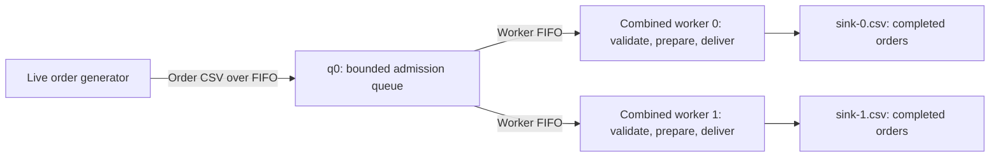
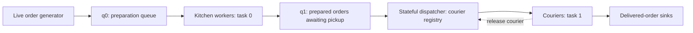
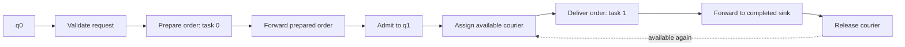

# Food delivery: preparation and courier dispatch

Objective B application. One job is one customer order at restaurant `r0`.
The question is: **when does kitchen capacity stop helping because courier
availability becomes the bottleneck?** Optimize delivered orders per second,
end-to-end latency, pickup wait, and loss together.

This follows the matchmaking branch's application layout, three-column job
format, metadata-in-ID convention, and monolithic/staged comparison. It uses
the existing Objective A queue process, job parser, event helpers, and analysis
tools. Shared logging now supports an optional compact style, and its analysis
parser accepts both styles. No other application branches are required.
The fetched smart-lock branch had no application source to reference.

## Problem, queueing model, and optimization goal

Customer orders compete for limited food-preparation and delivery capacity.
When arrivals outpace service, orders wait longer; when a buffer fills, new
orders may be rejected. We want to deliver more of the offered workload with
shorter customer waits using a fixed resource budget. Low latency alone is not
success if the system achieves it by dropping many orders.

For the **monolithic Objective B baseline**, one job is an order, q0 is its
waiting queue, and each server is a combined fulfillment worker. A worker
validates the order, prepares all its items (task 0), and delivers it (task 1)
before accepting another order. Its service time is preparation plus delivery.
This is a simplified combined resource, not a claim that a real cook also drives.
The staged extension separates those resource pools to explore kitchen versus
courier bottlenecks.

Arrivals have independent exponential gaps; service durations vary with item
count and distance. Conceptually this is an M/G/c queue in monolithic mode,
with configured finite admission buffering. The real FIFO implementation also
has transport buffers, so the configured queue size is not a bound on total
backlog (see measurement limits below). Orders leave each pending queue in FIFO
order, but parallel workers can finish them in a different order.

Interpret results as follows:

| Metric | Application meaning and interpretation |
| --- | --- |
| Delivered throughput | Delivered orders divided by the observed seconds from first generation to last event. Higher is better at comparable offered load and resource counts; this finite-run value includes draining the workload. |
| End-to-end latency | Sink departure time minus original generation time, for delivered orders. Includes queueing, transport, preparation, and delivery. Lower is better; report drops alongside it. |
| Pickup wait (stages only) | Courier service entry minus kitchen service exit. Includes transfer and dispatch waiting; growth suggests courier capacity is insufficient. It is not applicable to the monolith. |
| Utilization | Busy workers relative to configured workers. In the monolith, busy time covers both tasks; in stages, inspect kitchens and couriers separately. High utilization with rising waits suggests a bottleneck, not necessarily a desirable outcome. |
| Saturation | Orders waiting for service. The normalized qmet counts queue admission through server entry, including transport waits. Sustained growth indicates demand exceeding available service. |
| Errors/loss | Queue-full rejections; report dropped/generated as the loss fraction. In stages, pickup overflow wastes preparation already performed. Incomplete orders or process failures are failed runs, not successful deliveries. |

The optimization goal is to **increase delivered throughput while reducing
delivery latency and order loss under a stated resource budget**. Compare the
same arrival rate, order mix, time scale, and seeds; vary worker counts or queue
capacities separately. More buffering can reduce drops while increasing waits.
The current analysis reports counts and mean timings; USE plots are available
with `--plots`, subject to the sampling limitations below. This implementation
does not claim an experimentally established optimum.

## Run on macOS or Linux

From the repository root, using Python 3.10+:

```bash
python3 implementation/obj-b.food-delivery/run_demo.py
```

The default is a **live**, concurrent pipeline of two bounded queues, two
kitchen processes, and one stateful dispatcher with three courier threads,
with 100 orders. The generator
writes arrivals to a named pipe while the workers are running. Each run gets
a new directory under `runs/`; existing nonempty output directories are refused.

```bash
# Quick smoke run; scale arrival and service times together.
python3 implementation/obj-b.food-delivery/run_demo.py --count 20 --time-scale 0.2

# Execute both tasks in a single worker visit instead of separate stages.
python3 implementation/obj-b.food-delivery/run_demo.py --mode monolith --count 20

# Include the shared plots (requires numpy, pandas, matplotlib).
python3 implementation/obj-b.food-delivery/run_demo.py --count 30 --plots

# Use a modified copy of the baseline configuration for resource experiments.
python3 implementation/obj-b.food-delivery/run_demo.py --config my-config.json --workdir /tmp/food-run-1

python3 -m unittest discover -s implementation/obj-b.food-delivery/tests -v
```

The core run, normalized logs, per-order metrics, and summary require only the
standard library. Plotting dependencies can be installed in your Python virtual
environment with `python3 -m pip install numpy pandas matplotlib`.
Native Windows requires WSL for this FIFO runner. A C++/gRPC server-function
port is also available; see [build and run instructions](cpp/README.md). It uses
`run_grpc.py` and leaves the Python/FIFO runner available. Containers are not
implemented for this application yet; Objective A's gRPC libraries are unchanged.

## Model and architecture

### Monolithic baseline



The default configuration supplies two combined workers. Each is a separate
process running the same monolithic server function. Validation checks encoded
metadata, restaurant r0, and the ordered task IDs 0 and 1. The function logs
one service entry, executes both waits sequentially, logs service exit, and
writes the unchanged job row to its sink. It stays occupied throughout both
tasks; no intermediate queue or dispatcher participates. The generator and
q0 run concurrently in separate processes. Logs and sink records feed analysis
after all workers finish.

### Staged extension



Kitchen processing is stateless: a visit depends only on the current order.
The dispatcher (`fd/dispatch.py`) owns the q1 pickup queue and an explicit
registry of courier status, assigned order ID, and completed-order count.
Admission, assignment, and release share a condition lock. An available courier
takes the oldest admitted order and becomes `busy` before service. It becomes
`available` after delivery and sink output finish. There are no per-courier
pipes or prefetched assignments; a courier cannot hold two active orders.
Available couriers compete for the next order; there is no fairness guarantee
between couriers or route optimization.

Each transition atomically updates `dispatch-state.json`. This is an inspection
snapshot, not crash recovery. A failed delivery marks the courier `failed` and
fails the run. Separate sink files avoid concurrent writes. Batching, payments,
cancellation, return trips, and cross-restaurant routing remain outside this
model. The standalone courier stage and monolith do not use this registry.

The monolith uses `kitchen_workers` combined worker processes; each holds its
resource through both preparation and delivery. `couriers` and `pickup_capacity`
do not apply in monolithic mode. This is a structural comparison, **not** an
equal-resource performance comparison with the default staged configuration.

## Server-function decomposition

`fd/services.py` separates application work from process startup and FIFO I/O.
`fd/server.py` is the common service-visit wrapper: validate, log service entry,
call the selected operation, log service exit, and forward the original row.
The monolith composes the same preparation and delivery operations in one
visit; the staged deployment executes them on different worker resources.

| Function | Responsibility | State |
| --- | --- | --- |
| `validate_request` | Check order metadata, restaurant r0, and task layout before work starts. | Current request only |
| `prepare_order` | Execute task 0, with task-start/end events. | Current request only |
| `Dispatcher.admit` | Admit a prepared order into the bounded pickup queue, or record a drop. | Pending queue and accepted IDs |
| `Dispatcher.assign_next` | Reserve an available courier for the oldest pending order. | Shared courier registry under a lock |
| `deliver_order` | Execute task 1, with task-start/end events. | Current request only; reservation is owned by dispatch |
| `forward_order` | Write and flush the unchanged row, then log departure. At the final sink this records completion. | Output stream |
| `Dispatcher.release` | Verify the active order, increment completed count, and make the courier available. | Shared courier registry under a lock |



These are logical function boundaries. Preparation and delivery remain the two
timed service stages with queues q0 and q1; validation, handoff, and state
transitions do not introduce extra queues or synthetic waits. The live runner
launches `server-stages/kitchen.py` for preparation and runs delivery workers
inside the dispatcher so all couriers share one authoritative registry.
`server-stages/courier.py` also exposes delivery as an independent file/FIFO
program for isolation tests. It does not implement fleet-wide dispatch on its
own. The original `server-stages/server_func.py --stage kitchen|courier`
interface remains supported.

For an isolated, sequential demonstration, use fresh output paths (standalone
servers append output). This demonstrates service composition, not live queueing:

```bash
demo_dir=$(mktemp -d)
python3 implementation/obj-b.food-delivery/workload-generator/workload_generator.py \
  --count 10 --seed 1 --out "$demo_dir/orders.csv"
python3 implementation/obj-b.food-delivery/server-stages/kitchen.py \
  -i "$demo_dir/orders.csv" -o "$demo_dir/prepared.csv" --qid q0 \
  --logfile "$demo_dir/kitchen.log"
python3 implementation/obj-b.food-delivery/server-stages/courier.py \
  -i "$demo_dir/prepared.csv" -o "$demo_dir/delivered.csv" --qid q1 \
  --logfile "$demo_dir/courier.log"
```

Use `run_demo.py --mode stages` for the concurrent queue/dispatcher experiment.
The workload schema, durations, queue IDs, log format, and analysis outputs stay
the same in the Python implementation. The subsequent [C++/gRPC port](cpp/README.md)
uses these same service boundaries with a separate runner.
Tests cover the standalone composition, both live modes, single-task ownership,
failed output, and rejected duplicate/mismatched courier state transitions.

## Order and workload

Job ID `o42.r0.far.i3` means order 42, restaurant 0, far delivery zone, three items.
The shared CSV columns remain `Job Id,arrival time,Tasks`:

- Task 0: preparation seconds. Uniform 0.02–0.04 per item, with 1–4 items.
- Task 1: delivery seconds. Uniform 0.04–0.06 multiplied by 1/2/3 for near/mid/far.
- Interarrival times: exponential with configurable mean (default 0.04 seconds).
  Mean 0 produces a burst. This models Poisson arrivals through exponential
  delays, rather than using integer Poisson draws as sleep times.
- `time_scale` multiplies both arrival and service durations once, in generation.
  Wait durations are then rounded to three decimal places in seconds (e.g. `W 0.029`)
  in the CSV and logs; workers sleep for those rounded durations. Very small
  scaled waits below 0.0005 seconds round to zero.
  These are synthetic, accelerated durations, not measured restaurant data.
- Seeded arrival and attribute streams are separate. Changing arrival rate does
  not change order attributes. Real scheduling and timestamps are not reproducible.

Design decisions: exponential gaps model independent customer arrivals at a
constant average rate (25 orders/second with the default mean 0.04). A burst
with mean 0 is a separate stress case. Zones are sampled uniformly from
near/mid/far and item counts uniformly from 1–4, providing a simple balanced
mix without assuming measured customer preferences. Bounded uniform base
durations provide variation without extreme service-time outliers; item count
increases preparation work and zone multipliers model longer travel. These
choices are synthetic assumptions, not fitted real-world distributions.

Before millisecond rounding and runtime overhead, mean preparation is
0.03 × 2.5 = 0.075 seconds and mean delivery is 0.05 × 2 = 0.100 seconds.
Thus one combined worker has a nominal mean service time of 0.175 seconds;
two workers offer roughly 11.4 orders/second of nominal capacity. The default
25-orders/second arrival rate intentionally stresses the monolithic baseline.
For a lighter-load comparison, use `--arrival-mean 0.12` (about 8.3 orders/second).
These are analytical estimates, not measured throughput guarantees.

Each stage selects only its task; the raw row is preserved so order identity
and the original arrival timestamp survive all hops. Invalid metadata or missing,
duplicate, or reordered stage tasks fail the server and therefore the run.

Standalone generator (omit `--count` for continuous generation):

```bash
python3 implementation/obj-b.food-delivery/workload-generator/workload_generator.py \
  --count 20 --seed 1 --arrival-mean 0.04 --out /tmp/orders.csv
```

## Configuration and artifacts

`topology/baseline.json` sets worker counts, queue capacities, count, arrival mean,
time scale, and seed. The runner starts sink readers first, then upstream queues
and workers, and finally the generator. Closing each producer propagates EOF
downstream. A timeout or child failure terminates and reaps all remaining children,
removes temporary pipes, preserves logs, and exits nonzero.

Each run contains:

- `config.json`, `jobs.csv`: exact configuration and emitted workload.
- `q0.log`, `q1.log`, worker logs, `*.stderr`: raw evidence and diagnostics.
- `sink-*.csv`: delivered orders, one file per courier/combined worker.
- `dispatch-state.json`: live courier registry and waiting-order IDs (staged mode).
- `analysis/events.log`, `qmet.csv`, `qconf.csv`: Objective A-compatible inputs.
- `analysis/orders.csv`: each generated order's delivered/dropped/incomplete
  outcome, creation-to-delivery latency, and preparation-complete-to-pickup wait.
- `analysis/summary.json`: counts, mean latency, mean pickup wait, and delivered
  orders divided by elapsed time from first generation to last event.
- With `--plots`: shared USE, system metrics, visit metrics, traces, and figures.

The adapter uses known q0→q1→sink edges rather than guessing that every final
departure is a successful delivery. Pickup overflow is a dropped prepared order,
not a completed delivery. The runner rejects duplicate deliveries, unknown IDs,
modified rows, conflicting outcomes, and unaccounted orders. Queue drops are valid
experimental outcomes; an incomplete pipeline is a failed run.

New food-delivery logs use `date - Q - INFO - message` or
`date - sv - INFO - message`, without PID or hostname. The short component labels
are retained for analysis; queue/server IDs remain in event bodies. Other
applications keep their original prefixes unless `LAB_LOG_COMPACT=1` is set.
Existing logs are not rewritten, and both formats remain readable.

## Measurement limits and next experiments

The preparation `qsize` applies to the Objective A in-process buffer. OS pipes and
Python readers also buffer data, so this is **not a strict bound on all waiting
orders**. The normalized saturation counts admission through server entry,
including transport waiting. A short burst may fit in pipes and show no drops
even with a small `qsize`. Use a synchronous handoff or acknowledgement protocol
before claiming that configured capacity equals total system backlog.
The dispatcher bounds pending orders to `pickup_capacity`, excluding busy
couriers. Kitchen-to-dispatcher pipes still buffer data upstream of admission.
Writing registry snapshots adds disk I/O overhead to dispatch decisions.

Shared log timestamps have millisecond precision. The adapter orders same-time
events causally within each order/queue. Avoid excessively small time scales for
performance studies. Shared USE rolling windows average event samples, not wall
time; do not present those as time-weighted utilization. The standalone
`derive-event-metrics` column called response time is queue waiting time; use our
`end_to_end_seconds` for customer delivery latency. Durations include simulated
sleep and scheduling overhead, not actual network/restaurant measurements.

This is a runnable initial application, not a completed scale study. Next:
compare FIFO and gRPC buffering/backpressure, then run baseline
and +25/+50/+100/-10/-20/-30 resource scenarios with repeated seeds. Vary kitchen
workers and couriers separately, hold workload fixed, record actual integer
resource counts, and include losses when comparing latency. Add restaurants and
zones with genuine routing before expanding to the larger queue scales.

## Regional medium-study runner

`run_network.py --config <network.json>` runs multiple restaurant queues feeding
shared regional pickup queues with C++/gRPC services. The network configuration
sets restaurant-to-region routes, demand weights, kitchen workers, and courier
counts by region. See the [20-queue medium study](../../analysis/simple/obj-b-food-delivery/medium/README.md)
for configurations, seven sensitivity sets, plots, and measured results.

### Large study: shared processes

`run_hosted.py --config CONFIG --workdir RUN_DIRECTORY` hosts restaurant and pickup
buffers on one asyncio loop, with two asynchronous C++ `food_host` processes.
Logical worker counts remain independent per queue. Arrival offsets are scheduled
against an absolute monotonic timeline and injection delay is recorded.

The [200-queue large study](../../analysis/simple/obj-b-food-delivery/large/README.md)
provides seven courier configurations, three paired seeds, a separate smoke-test
mode, six main plots per configuration, Objective A accessory outputs, resume
checks, and verified raw-run archives. Follow the
[VM instructions](../../analysis/simple/obj-b-food-delivery/large/VM.md) to build,
smoke-test, and run it under tmux. The full VM study is complete: 21 runs and 2.1 million orders, with all 42 main
plots and the measured analysis in the large-study directory. Raw archives remain
on the VM; local development pilots are separate from these final results.
