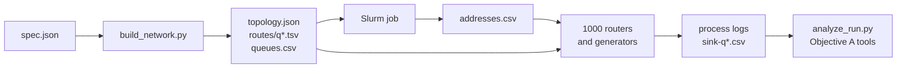
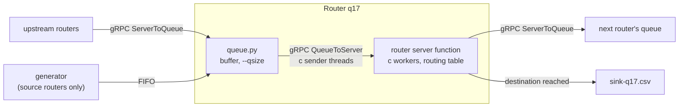
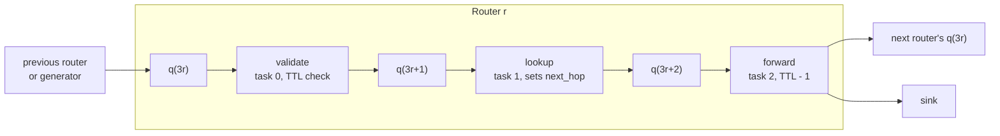
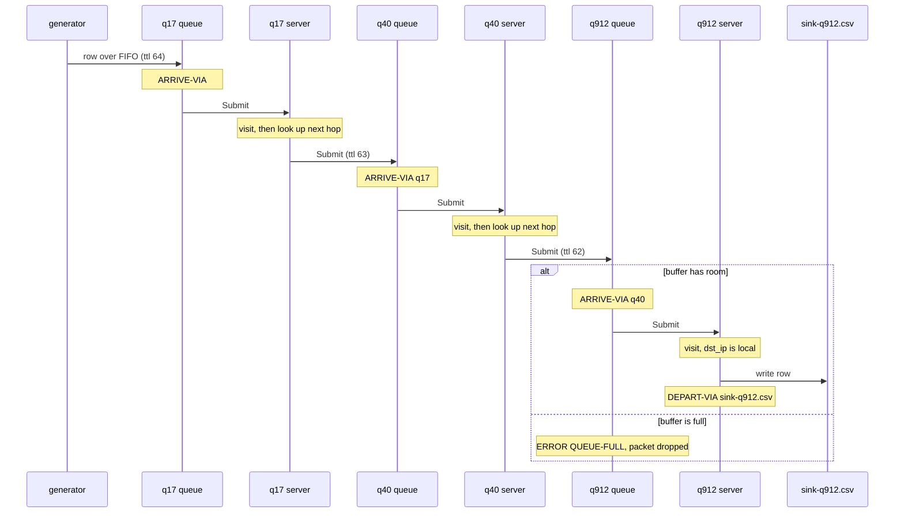
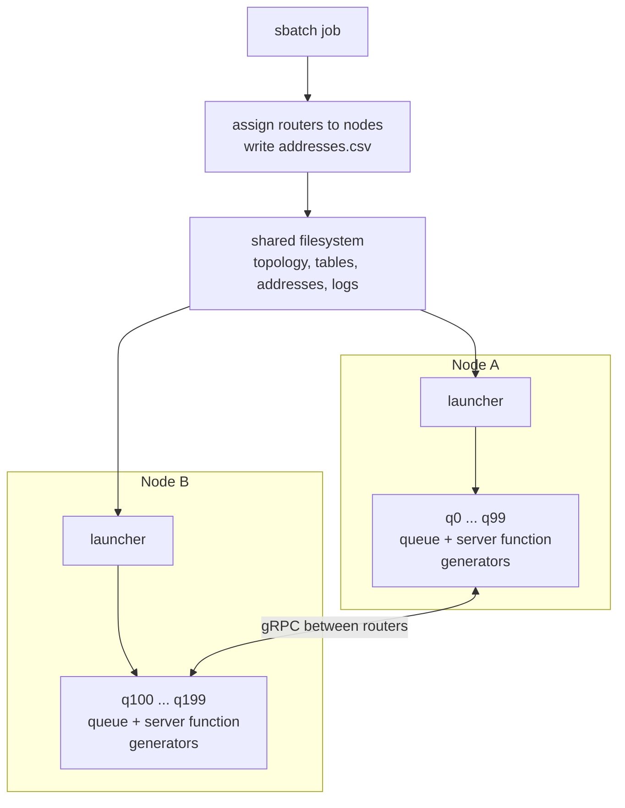

# Architecture

This is the design for the packet routing application. The problem and the queueing model are in [README.md](README.md). The shared programs come from the [Objective A framework](../obj-a/README.md). Everything here is implemented and tested locally, except the Slurm job, which is still the plan.

## Overview

A person edits one network spec. A build tool expands it into a topology, one routing table per router, and the queue sizes for analysis. A Slurm job then starts every router, runs the traffic, and stops the routers. The existing analysis tools read the logs.



The same tool builds every size. Only the router count in the spec changes, so a 10-router run on one machine exercises the same code as the 1000-router run.

## One router

One router is one queue system with two processes: the Objective A `queue.py` and a new routing server function. They share a queue id, `q0` to `q999`, and run on the same node.



The server count $c$ is set in two places, and they must match: the workers on the server function's `--ingrpc`, and the workers on the queue's `--outgrpc`. A sender thread stays inside `Submit` for the whole visit. That keeps waiting packets in the buffer, so `--qsize` and `metric-q-size` mean what they say.

One visit runs in this order:

1. Log `ENTERS-SERVER`, sleep each task's `W` between `TASK-START` and `TASK-END`, and log `EXITS-SERVER`.
2. A TTL of 0 or less logs `ERROR TTL-EXPIRED` and drops the packet.
3. Look up `dst_ip`. With no match, log `ERROR NO-OUT-EDGE` and drop the packet.
4. If the route is `local`, write the row to the sink and log `DEPART-VIA sink-q17.csv`.
5. Reduce the TTL by one. If it reaches 0, log `ERROR TTL-EXPIRED` and drop the packet.
6. Call `Submit` on the next hop's queue with the reduced TTL, and log `DEPART-VIA host:port`.

`QUEUE-FULL` is logged by the receiving queue. The sender still logs `DEPART-VIA`, because the packet left this router.

## Decomposing a router

The visit above is the [monolithic router](server-monolith/README.md). The [decomposed router](server-stages/README.md) splits it into three server functions, each with its own queue, so one router is three queue systems:



Both forms end every packet the same way. Each stage's queue shows which step limits a router, and a stage that drops a packet saves the later stages' work. A router's capacity changes, though, from $c / (W_0 + W_1 + W_2)$ to $c / \max(W_0, W_1, W_2)$, so the two forms should not be compared at the same `c` without saying so.

At this numbering, 1000 routers would be 3000 queues and 6000 processes. A 1000-queue decomposed network is about 333 routers.

## A packet's journey

A packet entering at `q17` and delivered at `q912`, through `q40`:



## Packet format

Inside the network, the destination and TTL are fields of the gRPC message. These are additions to `job.proto`:

```proto
message Job {
  string job_id = 1;
  double arrival_time = 2;
  repeated Task tasks = 3;
  string raw_line = 4;
  fixed32 dst_ip = 5;   // IPv4 address as a 32-bit integer
  int32 ttl = 6;
  string next_hop = 7;  // Set by the lookup stage for the forward stage
}
```

The generator cannot speak gRPC, so its FIFO row carries the starting values in two extra columns:

```text
Job Id,arrival time,Tasks,Dst IP,TTL
p17-42,1760990100.123,"[""0: W 0.005000"", ""1: W 0.015000"", ""2: W 0.050779""]",10.3.144.7,64
```

The job id is `p{source router}-{sequence}`, which keeps ids unique across generators without any coordination. The row stays unchanged for the packet's whole path. The message is what counts after the first queue, because the TTL changes at each hop.

That needs these changes to shared Objective A code, all of them backward compatible:

| File | Change |
| --- | --- |
| `proto/job.proto` | Add the two fields and regenerate the stubs |
| `lib/job.py` | `Job` gains `dst_ip`, `ttl`, and `next_hop`, which default to empty. `parse_job_line` and `is_header` also accept the 5-column form. |
| `lib/grpc_runtime.py` | `_request` sends the fields. `job_from_message` takes them from the message rather than from `raw_line`, or the TTL would reset at every hop. |
| `lib/events.py` | Add `error_ttl_expired` |

A missing TTL reads as 0, so every packet must start with one. Other applications ignore these fields, so they are unaffected.

## Addressing and routing tables

Router $i$ owns the prefix `10.{i >> 8}.{i & 255}.0/24`. Router 17 owns `10.0.17.0/24`, and router 912 owns `10.3.144.0/24`.

The build tool runs a breadth-first search from each destination router over the links, which gives every router its next hop towards that destination. Ties go to the lowest queue id, so a seed always produces the same tables. Each router gets one file:

```text
# routes/q17.tsv: prefix, next hop
10.0.0.0/24	q40
10.3.144.0/24	q40
10.0.17.0/24	local
```

Lookup is longest-prefix match, parsed into integers at startup. Generated prefixes are all `/24`, and a table with coarser routes works without code changes. Using a different routing policy means generating different tables.

The tables are static, so a loop cannot appear during a run. The build tool follows the path of every source-destination pair and fails if any path does not reach its destination, or is longer than the starting TTL. The runtime TTL of 64 is a second guard and also models IP's behavior. It should never fire.

## Generating the network

`spec.json` is the only file a person edits:

```json
{
  "routers": 1000,
  "seed": 7,
  "topology": "topology/as20000102.txt",
  "degree_per_server": 70,
  "qsize_per_server": 4,
  "min_qsize": 8,
  "validate_wait": 0.005,
  "lookup_wait": 0.015,
  "forward_wait_mean": 0.03,
  "ttl": 64,
  "sources": 100,
  "packets_per_second": 20,
  "duration_seconds": 60
}
```

A router gets `max(1, ceil(links / degree_per_server))` servers and a buffer of `max(min_qsize, qsize_per_server * servers)`. These are starting values. A run should recheck them against the $\rho_i$ prediction from the README.

A study can set `total_servers` instead, which splits that budget in proportion to each router's predicted load. It can also set `buffer_servers`, which sizes buffers from a different budget, so a sweep changes servers alone. `traffic_seed` changes the packets without changing the network.

**Topology.** The routers are a random-walk sample of the SNAP `as-733` Autonomous System graph (`as20000102.txt`, 6,474 networks, from a real snapshot of 2 January 2000). The walk starts at a random network, steps to a random neighbor, and keeps each network it visits until it has enough. The links among those networks are kept.

The sampling method changes the network a lot, so it is fixed in the build tool:

| Method | Connected | Largest router's links | Mean hops | Longest path found |
| --- | --- | --- | --- | --- |
| Full graph | Yes | 1458 | 3.67 | 8 |
| Random walk, seed 7 (chosen) | Yes | 303 | 3.31 | 9 |
| Spread out from the largest hub | Yes | 999 | 1.99 | 2 |
| 1000 best-connected networks | No | 387 | 2.92 | 7 |

The seed 7 row is exact, from the build's all-pairs check. The other rows' mean hops and longest paths are estimates from 100 starting routers. The seed 7 sample has 2,707 links. It has fewer one-link routers than the full graph (22% against 37%), so results describe a somewhat better connected network than the real one.

The build tool writes:

| File | Used by |
| --- | --- |
| `topology.json` | The launcher: routers, links, servers, buffer sizes, sources |
| `routes/q*.tsv` | The router server functions |
| `queues.csv` | `analyze_run.py`, for each queue's size and server count |
| `addresses.csv` | Every server function, to find the next queue |

## Traffic

A new packet generator runs once per source router. Source routers are drawn with the build seed from the one-link routers, which is where traffic enters the network. The seed 7 sample has about 220 of them, so the spec starts with 100 sources. `packets_per_second` is the total across all of them.

Each generator draws a gap from an exponential distribution and sleeps it, then draws a destination router, a random host inside its prefix, and a packet size. It writes one flushed row per packet. The Objective A generator cannot do this: it has no destinations, and its `poisson` option sleeps whole seconds. The [generator README](workload-generator/README.md) gives the reasoning behind each distribution.

The generator stays running during the test, so packets reach the queue with their real spacing. A row that already sits in a finished file would lose that timing, because the queue ignores the arrival column.

## Running at 1000 queues

The studies in [analysis/obj-b-packets](../../analysis/obj-b-packets/README.md) run every model on one node, up to 10,200 queues on one of Sooner's 2 TB `largemem` nodes. That avoids a launcher on each node. The multi-node layout below is the design for a network that doesn't fit one node, and it is not written.

The 1000-router run happens on OU's Sooner supercomputer. One `sbatch` job runs 2000 router processes plus the generators. The node list is only known once the job starts, so host and port assignment happens at that point rather than at build time.



`addresses.csv` maps each queue id to its host, with the queue on port `20000 + n` and the server function on port `26000 + n`, where `n` counts that host's queues from 0. Those ports are below Linux's usual ephemeral range, so a host holds at most 6000 queues. On one machine, a run with more queues also listens on 127.0.0.2 and up, which reach the same machine. Each process listens on its own address rather than on every interface, so the addresses don't collide. The job should request exclusive nodes (`--exclusive`) so another job cannot hold them.

A run goes through these steps:

1. **Assign.** Read `SLURM_JOB_NODELIST`, spread routers evenly across nodes, and write `addresses.csv`.
2. **Launch.** `srun` starts one launcher per node, which starts that node's processes.
3. **Start server functions.** Wait until every log shows `gRPC listen`.
4. **Start queues.** Wait for the same line again.
5. **Start generators.** This is last, because each one's FIFO has to meet its queue.
6. **Wait for the end.** The generators have exited, and every packet in their `--copy` files is accounted for: delivered to a sink, or dropped with a logged error. A lost packet would hold this open, so Slurm's time limit is the backstop. `run_local.py` does the same with its own timeout.
7. **Stop.** Send SIGINT to the queues, then to the server functions. Listeners only stop on that signal.

Each process writes its own log on the shared filesystem, which makes 2000 or more log files. `metric-q-size` alone adds 10 lines per second per queue.

## Logs and metrics

The metrics are the ones in the README, from the existing tools. `analyze_run.py` merges the process logs into one event log and converts times to milliseconds, then runs `compute-use`, `derive-event-metrics`, `derive-sys-metrics`, and the plots.

The analysis tools act only on `QUEUE-FULL` among error kinds, so `TTL-EXPIRED` and `NO-OUT-EDGE` do not disturb them. The job ids contain no spaces, which is all those tools require.

`analyze_run.py` needed one fix for this application. On a rejected gRPC hop, the sender logs `DEPART-VIA host:port` and the receiver logs no arrival. The script kept a packet's last departure as its exit, so a dropped packet counted as delivered. A last departure to `host:port` now stays internal. `tests/test_packet_fields.py` in Objective A covers rejection and TTL expiry.

## Reused and new code

| Piece | Status |
| --- | --- |
| `obj-a/queue/queue.py` | Reused unchanged |
| `obj-a/lib/` and `obj-a/proto/` | Reused with the additions under [Packet format](#packet-format) |
| `obj-a/mockups/analyze_run.py` | Reused with the fix above. `run_local.py --analyze` calls it. |
| Objective A analysis tools | Reused unchanged |
| `build_network.py` | New: sampling, addresses, tables, path check, config files |
| `workload-generator/` | New: one traffic stream per source router |
| `server-monolith/`, `server-stages/`, `pk/` | New: the router server functions in Python |
| `cpp/` | New: the same server functions in C++ |
| `run_local.py` | New: a small network on one machine |
| Slurm jobs | One-node jobs for each model in `analysis/obj-b-packets/`. The multi-node launcher is not written. |

### Contract for the C++ server function

The [C++ port](cpp/README.md) can replace the Python server function on any router, because it keeps to this contract. `tests/test_parity_and_network.py` enforces it. Queues stay in Python.

| Item | Requirement |
| --- | --- |
| Flags | `--stage`, `--qid`, `--server-id`, `--ingrpc interface:port,workers`, `--routes`, `--addresses`, `--sink`, `--next-qid`, `--logfile` |
| RPC | Serves `QueueToServer`. Calls `ServerToQueue` on the next hop, setting `source_edge` to its own queue id. |
| Return timing | `Submit` returns only after the visit, including the forward |
| Input files | `routes/q*.tsv` and `addresses.csv` as described above |
| Log lines | The same prefix and event body as Objective A: `{time} {job} IN {qid} {KIND} ...`, with three decimals on the time |
| Shutdown | Stops cleanly on SIGINT and flushes its logs |
| Channels | One channel per next hop, opened once and shared by all workers |

## Known limits

- **Clock differences between nodes.** Timestamps come from each node's clock. A router's two processes share a node, so per-visit times are safe. End-to-end latency compares a source node with a destination node, so the skew should be measured and kept well below `W`.
- **Connection cost.** `submit_job` in Objective A opens a channel for each packet, and the Python queue and server function pay that on every hop. The C++ server function reuses its channels, but its queue still pays this on the hop into the server.
- **Measurement overhead.** `W` has to stay well above the cost of a hop. At low load, latency should be close to the number of routers on the path times `W`, and the gap is the overhead. In small local runs of 32 to 47 packets, the median overhead per visit was 4.6 to 5.0 ms with Python server functions and 2.1 to 3.6 ms with C++, against a mean `W` of 50 ms. That includes some real queuing, so it is an upper estimate.
- **Memory.** Measured in a small local run with traffic flowing, a Python queue used 42 MB (20 MB private), a Python server function 41 MB (19 MB private), and a C++ server function 18 MB (3 MB private). Sooner is hard to set up, so there are no trial runs there. These are the numbers to size the Slurm request from: 1000 routers with C++ server functions need at least about 23 GB of private memory across the job, plus the shared pages on each node.
