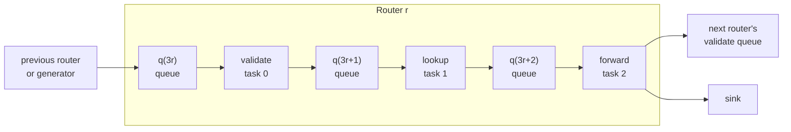

# Decomposed router

The [monolithic router's](../server-monolith/README.md) visit, split into three smaller server functions. Each stage has its own queue and its own server function, so one router is three queue systems. One program runs all three, and `--stage` selects the visit.

Back to the [application README](../README.md).



| Stage | Sleeps | Decides | Sends to |
| --- | --- | --- | --- |
| `validate` | Task 0 | A TTL of 0 or less logs `ERROR TTL-EXPIRED` and drops the packet | `--next-qid`, unchanged |
| `lookup` | Task 1 | No matching route logs `ERROR NO-OUT-EDGE` and drops the packet. Otherwise it writes the route into `next_hop`. | `--next-qid` |
| `forward` | Task 2 | `next_hop` of `local` delivers to the sink. Otherwise it reduces the TTL, and 0 logs `ERROR TTL-EXPIRED` and drops the packet. | The queue named by `next_hop`, with `next_hop` cleared |

The lookup result has to reach a different process, so it travels in the `next_hop` field of the gRPC `Job` message. The row itself is still forwarded unchanged.

## What changes compared with the monolith

Both forms end every packet the same way, and each packet sleeps the same total time per router. `tests/test_router.py` checks both across every combination of destination and TTL. Three things differ:

- **The bottleneck can be located.** Each stage has its own queue, utilization, and saturation, so the logs show which step limits a router.
- **Drops save work.** A packet dropped at `validate` or `lookup` skips the later stages' sleeps. The monolith sleeps all three first.
- **Each stage has its own buffer and its own hand-off.** A packet can now be dropped between stages inside a router, and every stage adds its own RPC overhead.

Each stage gets the router's full server count, so a decomposed router can hold up to three times as many packets in service as a monolithic one with the same `c`. Its capacity is limited by its slowest stage, $c / \max(W_0, W_1, W_2)$, rather than by $c / (W_0 + W_1 + W_2)$. The two forms should therefore not be compared at the same `c` without saying so.

## Queue numbering

Router `r` uses queues `3r`, `3r + 1`, and `3r + 2`. A routing table's next hop is the next router's first queue, and the table is read only by that router's lookup stage. At this numbering, 1000 routers is 3000 queues and 6000 processes.

## Flags

```text
python server_func.py
  --stage validate|lookup|forward
  --qid q51
  --ingrpc interface:port,workers
  --addresses addresses.csv
  [--next-qid q52]         validate and lookup
  [--routes routes/q52.tsv] lookup
  [--sink sink-q53.csv]    forward
  [--server-id 0]
  [--logfile PATH]
```
