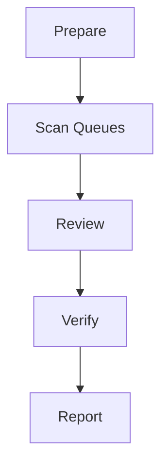
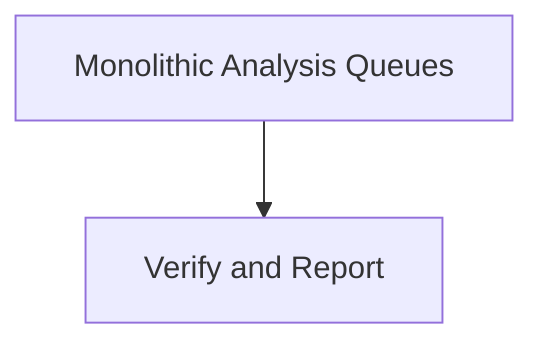
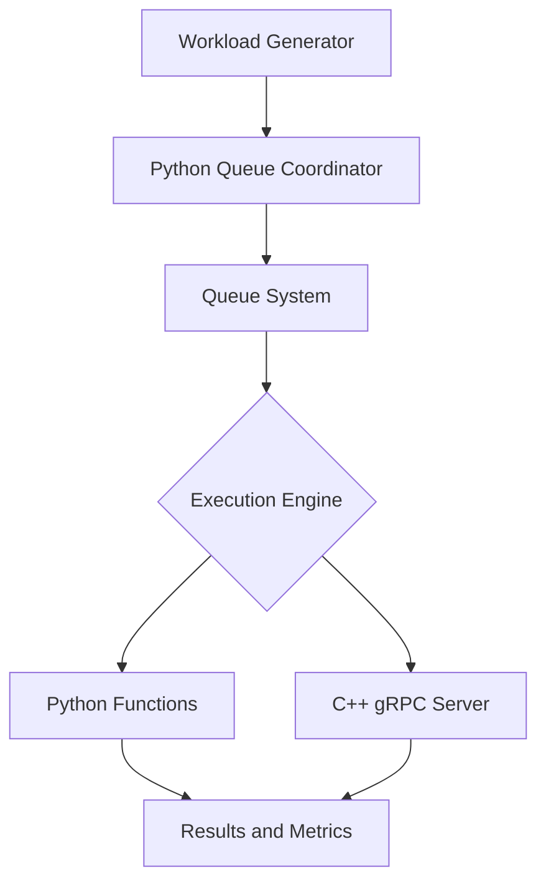

# HomeKey Firmware Analysis Architecture

## Problem

For Objective B, we're using a queue system to analyze HomeKey firmware for possible security issues.

The idea is to split the source analysis into smaller jobs that can run through different queues. Some of the analysis can happen in parallel since different source files and security checks don't depend on each other.

Physical verification is different because we're working with one ESP32, so that part has to happen one job at a time. I made that an optional thing tho so yeah that can be ignored really for this lab, that was just for fun.

We also want to measure how the queue system performs, including throughput, utilization, waiting times, latency, and errors.

The application focuses on source-code analysis and optional hardware verification. Finding a suspicious pattern doesn't automatically mean the firmware is vulnerable.

## Workload Generation

The workload generator reads the HomeKey source files and creates jobs for the different security checks.

It includes C, C++, header, and Arduino source files. Directories like `.git`, `build`, `.pio`, and `node_modules` are skipped.

There are three checks:

1. **Input bounds:** Looks for potentially unsafe operations like `strcpy`, `strcat`, `sprintf`, and `gets`.
2. **Authorization:** Looks for unlock-related code without nearby authorization identifiers.
3. **Replay:** Looks for unlock-related code without signs of freshness checks like nonces, counters, or timestamps.

Each job represents one source file and one check. The generator also supports repeating jobs to create a larger workload without needing more firmware files. Each job includes its source path, SHA-256 hash, check type, file size, and repeat pass. Copies of the source files are saved with the workload so the same source content can be used again.

The generator keeps the og source of truth Lab 0 workload format:

```text
Job Id,arrival time,Tasks
```

Tasks also use the original `tid: W N` format.

The W values are estimates based on the work involved, including source file size. They keep the workload compatible with the og format, but the application executes actual scanning functions rather than just decrementing simulated work.

The original Lab 0 distributions are used to generate arrival counts, including fixed, uniform, normal, geometric, and Poisson.

## Queue Architecture

The application supports decomposed and monolithic configurations.

### Decomposed Architecture

The decomposed version separates the application into five stages.

I tried on this little flow chart ok, I'm not good with markdown formatting


Each stage handles a different part of the analysis.

| Stage | Purpose |
|---|---|
| Prepare | Loads the source file and cleans the text |
| Scan | Runs the selected security check |
| Review | Determines whether candidates were found |
| Verify | Checks whether a candidate can be physically tested |
| Report | Saves the findings and finishes the job |

For Q total queues, the application uses:

- 1 Prepare queue
- Q - 4 Scan queues
- 1 Review queue
- 1 Verify queue
- 1 Report queue

With the default 6 queues, there are 2 Scan queues.

The Scan queues handle independent file and check jobs, so those jobs can be processed in parallel.

Every job moves through Prepare, Scan, Review, Verify, and Report. Jobs without findings still pass through Verify, but they don't trigger physical testing.

### Monolithic Architecture

The monolithic version combines Prepare, Scan, and Review into one function.



For Q total queues, Q - 1 queues run the combined analysis function, and the final queue handles verification and reporting.

This version reduces the number of queue transfers per job. Comparing the two architectures helps us see whether splitting work into separate stages improves throughput or creates additional waiting and communication overhead.

## Queue Scheduling

Each queue has its own waiting line, server slots, and capacity limit. Jobs are handled using first-come, first-served scheduling. When a server slot becomes available, the next waiting job can begin processing.

The coordinator uses round-robin routing when multiple outgoing queues are available.

The application also uses a shared pool of compute workers. This means having 128 queues doesn't mean we have 128 separate CPU workers. The default setup has 4 compute workers. Multiple queues can have jobs waiting or assigned to logical server slots, but the compute pool limits how much work can actually run at once.

The Verify stage uses a separate single worker for physical testing. This prevents multiple jobs from trying to use the same ESP32 at the same time.

Increasing the number of queues might improve parallelism, but it won't necessarily improve throughput if the worker pool is already fully utilized.

## Application Functions

The main application functions are implemented in Python, with a C++ version available through gRPC.

### Prepare

Prepare loads the source snapshot associated with the job. It checks the source identity and creates a cleaned version of the text for analysis. Comments and string literals are removed so the scanner can focus on the actual code.

### Scan

Scan runs the requested security check against the prepared source.

It searches for patterns related to unsafe input operations, missing authorization indicators, or missing replay protection indicators. The output is a list of possible candidate locations.

### Review

Review looks at the candidate list and determines whether the job found anything suspicious.

A job can finish with no candidates or one or more candidates that need further investigation. The review stage doesn't establish whether a candidate is actually exploitable.

### Verify

Verify checks whether a candidate has a matching target-specific test plan.

If no matching plan exists, the finding is marked as needing a target-specific test.

If a plan exists but the ESP32 isn't connected, the finding is marked as awaiting hardware.

When physical testing is available, the verifier communicates with the ESP32 through the serial adapter.

It checks the firmware build, establishes the expected initial state, sends the configured commands, and observes the response.

Only an actual response from the firmware can establish whether an unexpected unlock happened.

### Report

Report records the analysis results and verification status.

It writes the findings and allows the job to leave the queue system.

The final results include source analysis candidates, verification information, and completed job records.

## Python and C++ Implementation

The queue coordinator, scheduling logic, and metrics are handled in Python.

The application functions can run in Python or through a C++ gRPC backend.



The C++ implementation handles Prepare, Scan, Review, Report, and Monolithic functions.

The Python coordinator is still responsible for moving jobs between queues and managing the worker pool.

Hardware communication also stays in Python through the serial adapter.

Everything runs on the same host by default. The queues are separate logical waiting lines, not separate physical computers.

The C++ implementation gives us another way to run the application functions and compare execution behavior.

## Metrics and Logging

The application records events throughout each job's execution.

These include arrivals, queue entry, service starts, service completions, transfers, and departures.

The event log is handled by `event_log.py`, and queue measurements are written by `metrics_writer.py`.

The main measurements are:

| Metric | Meaning |
|---|---|
| Utilization | Fraction of logical server capacity occupied |
| Saturation | Number of jobs waiting in the queue |
| Errors | Failed jobs and capacity rejections |
| Throughput | Number of completed jobs per time period |
| Waiting time | Time spent waiting before processing |
| Service time | Time spent processing |
| End-to-end latency | Total time from admission to completion |

Utilization measures how busy the logical server slots are, not actual CPU utilization.

The event log also includes processing overhead, such as dispatching jobs and communicating with the C++ backend.

Timing is based on wall-clock execution rather than simulated time.

Event timestamps use 100-microsecond ticks by default, while workload arrival steps default to 1 millisecond.

The metrics file uses periodic snapshots. At larger queue scales, the snapshots can be downsampled to avoid generating unnecessarily large files.

Some short jobs may start and finish between snapshots, so the event logs are used for more detailed timing measurements.

The `metrics-info.json` file records the timing units and settings used during the run.

## Objective A Integration

We're reusing the Objective A tools instead of creating another set of graphing scripts.

The application keeps the original workload, queue configuration, metrics, and event formats so those tools can read the results.

The analysis scripts generate:

- Queue utilization graphs
- System metric graphs
- Waiting time histograms
- Service time histograms
- Arrival latency graphs
- Longest job traces

These graphs let us compare the queues and see where jobs spend the most time.

For example, if Prepare has a long waiting time while Scan has available capacity, adding more Scan queues probably won't solve the main bottleneck.

The event logs also let us inspect individual job paths through the application.

## Physical Verification

Physical verification is optional and doesn't affect whether we can run the queue experiments.

We're using an ESP32 as the hardware target. The application communicates with it through `hardware.py`.

A physical test requires a target-specific test catalog containing information about the firmware build and the commands to execute.

Tests are matched to source findings using the source hash, rule, and line number.

Before running a test, the verifier checks that the ESP32 is running the expected firmware build.

The test also needs to establish a known initial state, such as the lock being locked and no authorized unlock having occurred.

The test then sends the configured commands and observes the firmware response.

Possible outcomes include:

- No supported test available
- Awaiting hardware
- Issue not reproduced
- Unexpected unlock
- Test error

A timeout or failed setup doesn't count as an unexpected unlock.

Repeated findings are also deduplicated for physical verification so the same candidate doesn't need to be tested multiple times.

The purpose of this stage is to separate possible source-code problems from issues that can actually be reproduced on the target hardware.

## Scaling Experiments

We test four different queue scales:

| Scale | Total Queues | Scan Queues in Decomposed Mode |
|---|---:|---:|
| Small | 6 | 2 |
| Medium | 16 | 12 |
| Large | 128 | 124 |
| Very large | 1024 | 1020 |

Each scale includes seven configurations.

| Experiment | Change |
|---|---|
| Baseline | Default configuration |
| Slower arrivals | Reduces the incoming workload rate |
| Burst arrivals | Creates more concentrated arrivals |
| One worker | Reduces the shared compute pool |
| Eight workers | Increases the shared compute pool |
| Additional slots | Uses two logical server slots per compute queue |
| Monolithic | Combines the analysis stages |

The experiments use seeded workloads so results can be compared under consistent settings.

Repeat passes increase the workload size without representing new firmware discoveries.

The goal is to understand how the application responds to changes in queue count, worker availability, and incoming load.

We want to see which configurations improve throughput and reduce latency without creating unnecessary drops.

Also want to see whether the decomposed design benefits from additional Scan queues or whether shared stages like Prepare and Review become bottlenecks.

More queues don't automatically mean better performance, especially when they're sharing the same compute workers. A faster run doesn't necessarily mean the firmware is more secure. It just means the analysis workload was processed more efficiently.

## Limitations

The source scanner uses pattern-based checks rather than a complete understanding of the firmware. It doesn't build a full call graph or prove whether authorization and replay protections are correctly implemented. For example, an unlock function might have its authorization check in another function. The scanner could flag it even though the code is safe.

The opposite is also possible. The scanner could miss an issue because the vulnerable behavior doesn't match one of its patterns. This means the results can contain false positives and false negatives.

Physical verification also depends on having a supported test plan and a compatible ESP32 setup. The queue experiments mainly measure the performance of the analysis system.

This application gives us a way to run real firmware analysis through a configurable queue system and study how different architectures and workload settings affect its performance. It is also though just glorified grep.
